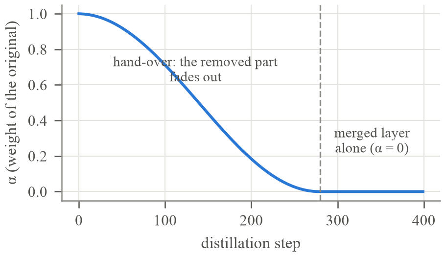
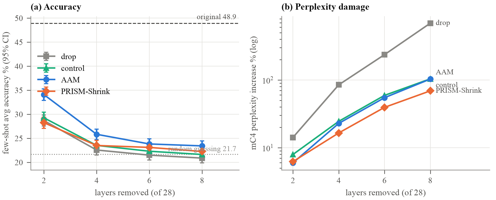

# AAM: Annealed Absorption Merging

**In one sentence:** for each pair of neighbouring layers, keep the better one, slowly fade the other out, and train
the kept layer to do the work of both by copying the original model's answers.

**Result in one sentence:** the most accurate method at every depth and on both model sizes (significantly better
than the matched control on every seed), but at 4+ layers removed from the 0.6B model it still keeps only about a
fifth of the original's above-chance skill.

New to the terms? Read [`../docs/metrics_and_benchmarks.md`](../docs/metrics_and_benchmarks.md) for the measurements
and Part 1 of [`../docs/layer_merging_explained.md`](../docs/layer_merging_explained.md) for transformer basics.

---

## 1. The idea in plain words

A transformer is a stack of layers. Each layer reads a running "notepad" of numbers for every token (the
**residual stream**), and adds a small correction to it. In the middle of the stack, two neighbouring layers make
similar, small corrections, so one of them can often learn to make both.

Analogy: two editors check a document one after the other. Instead of firing one editor on the spot (that is
**drop**), you let the better editor shadow the other for a few weeks while the other one does less and less, and the
better editor learns the missing checks. At the end the second editor leaves.

```
before:    ... ─► [layer 14] ─► [layer 15] ─► ...
during:    ... ─► [layer 14 × α] ─► [layer 15, learning] ─► ...     α goes 1 → 0
after:     ... ─► [layer 15, retrained] ─► ...                       one layer instead of two
```

## 2. The algorithm, step by step

1. **Choose which pairs to merge.** For each layer i, measure how much the hidden state changes from entering layer i
   to leaving layer i+1 (the *angular distance*, from Gromov et al.). Merge the pairs that change it least,
   never the first or last 2 layers. Qwen3-0.6B: 2 removed → pairs 12-13, 14-15; 4 removed → 10-11, 12-13, 14-15,
   16-17; 6 and 8 removed add 7-8, 24-25 and 5-6, 22-23.
2. **Choose which layer of each pair to keep.** Try each layer alone on held-out calibration text and measure how far
   its output is from the pair's real output (relative error). Keep the one with the lower error.
   Example from the logs: pair 14-15, layer 14 alone 28.9 %, layer 15 alone 26.6 % → keep layer 15.
3. **Wrap the other layer in a "fade".** Its output becomes `h + α · (layer(h) − h)`: at α = 1 it is the original
   layer, at α = 0 it does nothing (the token's state passes through unchanged).
4. **Distill** (train by copying the original model, the "teacher"). Only the kept layers are trained; everything else
   is frozen. Each step uses one 256-token Wikipedia passage per language (6 passages). The loss has two parts:
   - **KL divergence** between the teacher's and the student's next-token probabilities (over all 151,936 tokens);
   - **hidden-state MSE**: the student's state after the pair must match the teacher's.
5. **Anneal α** from 1 to 0 along a cosine curve over the first 280 of 400 steps, then train 120 more steps at α = 0,
   so the kept layer gets used to working alone.
6. **Remove the faded layers.** The final model has one layer per pair: a normal Qwen3 model with fewer layers.



**Training settings:** AdamW, learning rate 5e-5, gradient clipping 1.0, 400 steps (1,000 in the steps ablation),
fp16 mixed precision on one Kaggle T4. Safety check before training: at α = 1 the student must equal the original
model exactly (asserted).

## 3. Where it is in the code

Every notebook here is self-contained (same first cells in all of them):

| notebook section | what it does |
|---|---|
| Settings (`CFG`) and the override cell | model, languages, test sizes, layers to remove, seed, steps |
| Data | downloads Wiki-40B, mC4 and the five benchmarks; caches them |
| Few-shot evaluation | `evaluate`: perplexity, the five benchmarks, copying probe, speed |
| Original model, calibration states, planner | loads the teacher, `plan_pairs` (angular distance), `assemble` |
| Shared distillation code | `ALPHA`, `kd_losses`, `kd_train` |
| Algorithm | `Fade`, `pick_anchor` (step 2), `keep_one_build` (steps 3–6) |
| Run and results | `run_all`: builds the model for each number of layers removed, evaluates it, writes the results JSON |

`keep_one_build(plan, anchor="best", pack=False)` is AAM. The control in `../baselines/drop_kd_control/` is the same
function with `anchor="first"`, so the only difference is **which** layer is kept.

## 4. The runs and their numbers

Each notebook `X.ipynb` has its log and results in `runs/X/`. Accuracy = few-shot avg acc (chance 21.7 %);
skill kept = share of the original's above-chance skill (0 % = guessing).

| notebook | what it tests | model | layers removed | avg acc % | skill kept % | mC4 perplexity | copying |
|---|---|---|---|---|---|---|---|
| `aam_large_test` | main run | 0.6B | 2 | **34.1** | 53 | +6.0 % | 0.203 |
| `aam_large_test` | main run | 0.6B | 4 | **25.8** | 21 | +22.8 % | 0.337 |
| `aam_seed1` | same, seed 1 | 0.6B | 4 | 25.4 | 21 | +23.1 % | 0.502 |
| `aam_seed2` | same, seed 2 | 0.6B | 4 | 26.1 | 23 | +23.2 % | 0.333 |
| `aam_deep` | deeper cuts | 0.6B | 6 | 23.8 | 12 | +54.7 % | 0.519 |
| `aam_deep` | deeper cuts | 0.6B | 8 | 23.4 | 10 | +103.1 % | 0.766 |
| `aam_icl` | ICL-packed training text | 0.6B | 4 | 25.1 | 21 | +21.6 % | 0.246 |
| `aam_steps1000` | 1,000 training steps | 0.6B | 4 | 26.6 | 26 | +20.6 % | 0.513 |
| `aam_17b` | bigger model | 1.7B | 4 | **34.1** | 41 | +29.4 % | 0.450 |
| `aam` | earlier small test | 0.6B | 2 / 4 | 34.3 / 25.4 | — | +6.8 / +27.5 % | — |

Reference points: original 0.6B 48.9 % (copying 0.125); drop at 4 layers 22.6 % (+84.7 %, copying 2.22); original 1.7B
58.9 %. Every measurement per benchmark and language: [`../results/all_metrics.md`](../results/all_metrics.md).

**Compared with the matched control** (same training, first layer kept), paired on the same questions:

| setting | AAM − control | p-value |
|---|---|---|
| 0.6B, 2 layers | +4.8 | < 0.001 |
| 0.6B, 4 layers, seeds 0 / 1 / 2 | +2.3 / +1.8 / +2.6 | 0.002 / 0.009 / < 0.001 |
| 0.6B, 6 layers | +1.5 | 0.016 |
| 0.6B, 8 layers | +1.8 | 0.018 |
| 1.7B, 4 layers | +3.2 | < 0.001 |



## 5. What the experiments showed

- **The win comes from choosing the kept layer.** With the same training text, keeping the better layer instead of
  the first gives +1.6 to +2.5 points. The kind of training text changes accuracy by at most 0.8 points.
- **It is not luck:** three seeds give 25.8 ± 0.3.
- **Training longer barely helps:** 1,000 steps instead of 400 gives +0.8 (p = 0.05) and worse copying.
- **Bigger models keep more:** 41 % of the skill on 1.7B against 21 % on 0.6B at 4 layers.

**Weak points:**
- Its perplexity damage is higher than PRISM-Shrink's (+22.8 % vs +16.5 % at 4 layers).
- At 4+ layers on 0.6B it is close to random guessing, and maths (MGSM) is lost almost completely (41 % → 2 %).
- Its ingredients are known (layer pruning + distillation + gradual fading); what is specific here is the
  layer choice and the careful comparison.

More detail: [`../docs/algorithm_notes.md`](../docs/algorithm_notes.md) section 03, and
[`../docs/layer_merging_explained.md`](../docs/layer_merging_explained.md) sections 03 and 6.7.
