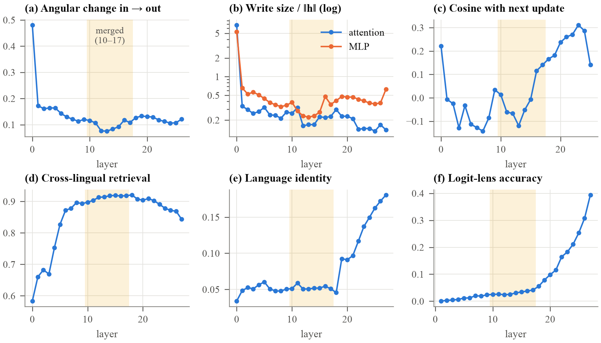
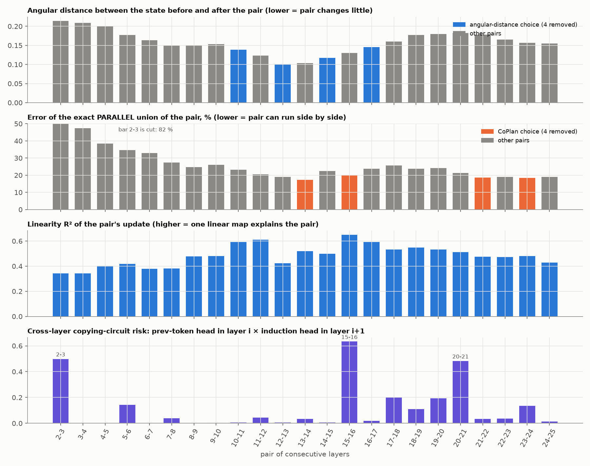
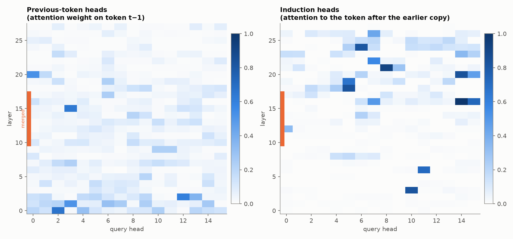

# Analysis: looking inside the model before cutting

These files come from **experiment 00** (layer analysis) and the attention-head analysis. Nothing is removed here;
the point is to find out which layers are safe to merge. All numbers are for Qwen3-0.6B-Base, measured on the
calibration text (Wiki-40B train, six languages). The layer-analysis notebook (experiment 00) was not kept. The
attention-head and test-set files come from the `p20a_data_refs` notebook, which is only in git history (commit
`f796be3`, `Assignment3/Sumit/paper/p20a_data_refs.ipynb`). See
[`../docs/limitations_and_issues.md`](../docs/limitations_and_issues.md) section 3. The explanation with figures is
Part 4 of [`../docs/layer_merging_explained.md`](../docs/layer_merging_explained.md).

---

## `layer_analysis/layer_analysis_Qwen3-0.6B-Base.csv`: one row per layer (28 rows)

| column | what it measures, in plain words |
|---|---|
| `angular change` | how much the layer turns the token's state (0 = no change). Small = the layer does little |
| `attn write / \|h\|` | size of what the attention part adds, relative to the size of the state |
| `mlp write / \|h\|` | the same for the MLP part |
| `update cos w/ next` | how similar this layer's update is to the next layer's (high = the two do similar work) |
| `language identity` | how well the language can be read from the state at this layer |
| `cross-lingual retrieval` | how well the same sentence in two languages ends up at similar states |
| `logit-lens acc (mean)` | how often the state at this layer, read directly as a next-token guess, is already right |

Layer 0 changes the state a lot (angular change 0.48). Layers 1–26 change it much less (0.08–0.17), and layers 12–15
the least (0.08–0.09), which is why the middle is where merging is tried. The last layer shows 0.00 because the file
has no value for it.

## `layer_analysis/pair_analysis_Qwen3-0.6B-Base.csv`: one row per pair of neighbouring layers

| column | meaning |
|---|---|
| `angular(in, out)` | angle between the state entering the pair and leaving it (small = the pair changes little = safer to merge). This is the score used to choose the pairs |
| `linearity R2` | how well a plain linear map reproduces the pair (1 = perfectly) |
| `mergeability rank` | a combined rank from the analysis notebook (lower = better candidate). It was **not** used to choose the pairs; the angular distance was |

## `attention_heads/heads_Qwen3-0.6B-Base.csv`: one row per attention head (28 layers × 16 heads)

| column | meaning |
|---|---|
| `prev_token` | how much the head looks at the previous token (a "previous-token head") |
| `induction` | how much the head finds the earlier copy of the current token and looks at what followed it (an "induction head", the copying circuit few-shot prompts depend on) |

## `attention_heads/pair_circuits_Qwen3-0.6B-Base.csv`: risk of breaking a copying circuit

Copying usually needs a previous-token head in one layer and an induction head in a later layer. Merging those two
layers into one could break the circuit.

| column | meaning |
|---|---|
| `max_prev_token_in_first` | strongest previous-token head in the first layer of the pair |
| `max_induction_in_second` | strongest induction head in the second layer |
| `composition_risk` | the product: high = merging this pair risks breaking copying |

Riskiest pairs: 15-16 (0.63), 2-3 (0.50), 20-21 (0.48). The pairs merged for 2 and 4 layers removed (10-11, 12-13,
14-15, 16-17) have very low risk (0.005–0.019). The extra pairs for 6 and 8 layers removed are 7-8 (0.039), 22-23
(0.036), 24-25 (0.014) and 5-6 (**0.144**, moderate), which fits the copying loss rising at 8 layers removed.

## `test_set/test_tokens_Qwen3-0.6B-Base.csv`: size of the test

Tokens per language and benchmark; every language has more than 100,000 unique test tokens. Table and explanation:
[`../docs/metrics_and_benchmarks.md`](../docs/metrics_and_benchmarks.md) section 2.
