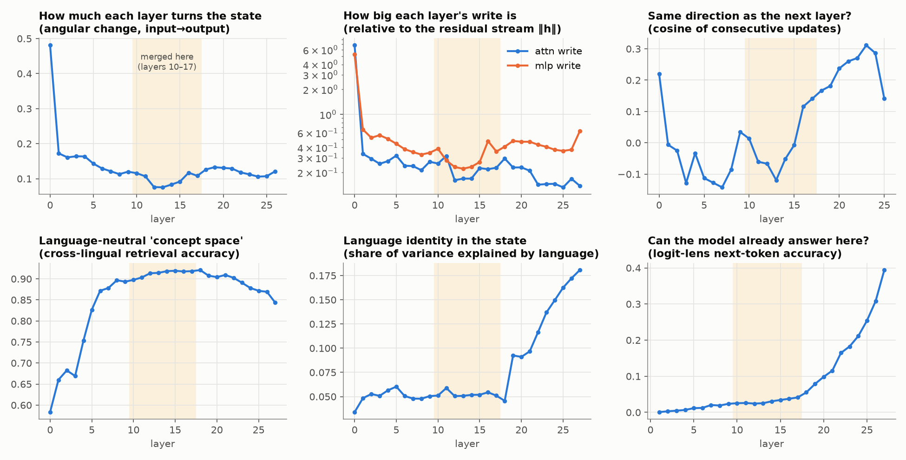
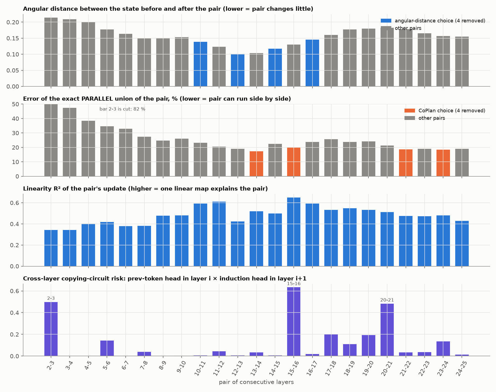
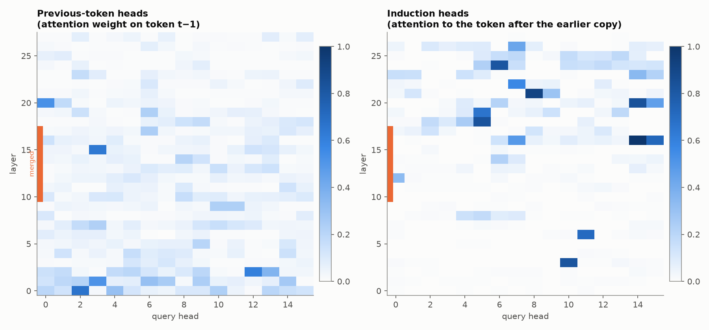
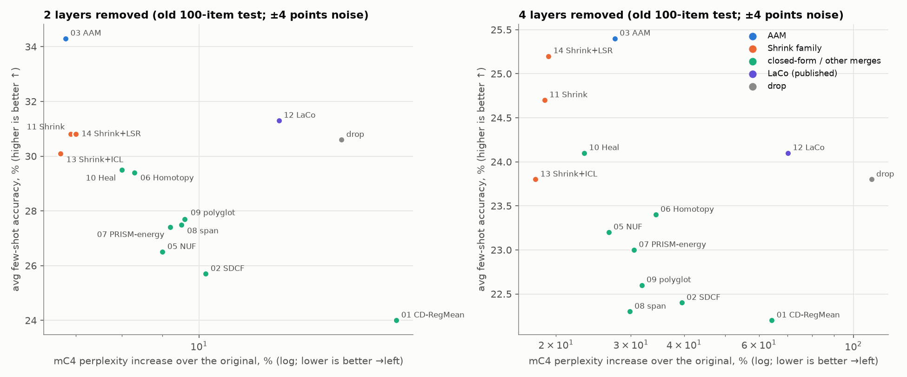
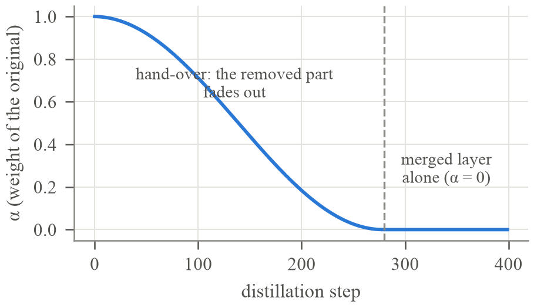
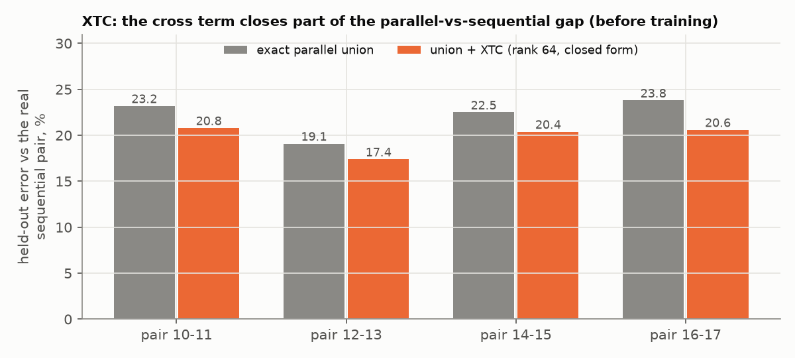
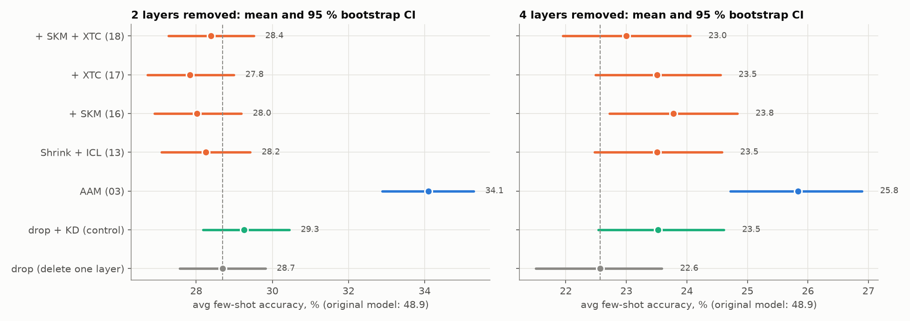
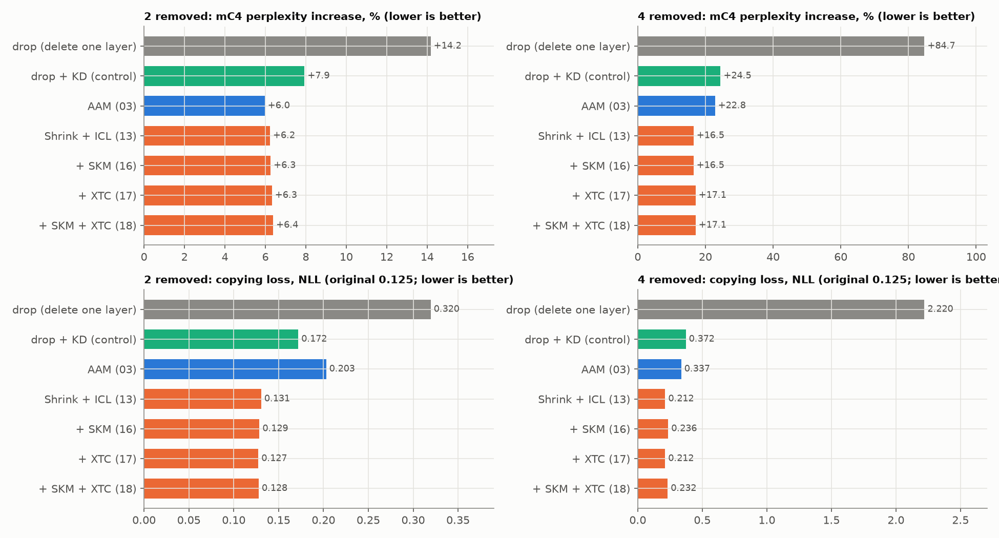
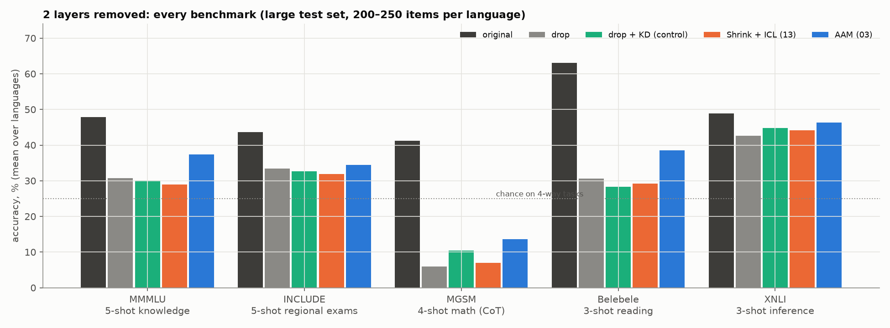
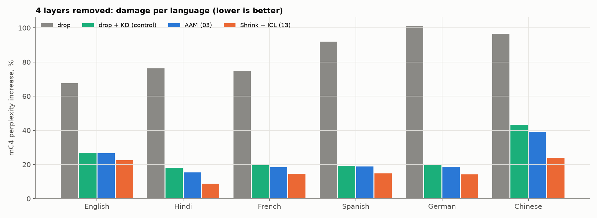

# Merging Layers of a Multilingual LLM: everything, explained from zero

**Who this is for:** someone who has never studied language models. Part 1 builds every idea you need from the
ground up. Parts 2–6 explain the research: what was tried, the maths, why it should work, and what actually happened.
Part 7 is the leaderboard. Part 8 answers the question *"was I successful?"* honestly.

**Model:** Qwen3-0.6B-Base (28 layers, 596 M parameters). **Languages:** English, Hindi, French, Spanish, German,
Chinese. **Hardware:** Kaggle T4 GPUs. **Code and runs:** `../prism_shrink/`, `../aam/`, `../baselines/` (see the main README).
**Figures:** `figures/`. The other experiments were removed from the repository; their numbers are kept here and in
`../results/`.

---

## Contents

- [The answer in 60 seconds](#the-answer-in-60-seconds)
- [Part 1. LLM basics, from zero](#part-1-llm-basics-from-zero)
- [Part 2. The problem: making the model shallower](#part-2-the-problem-making-the-model-shallower)
- [Part 3. How everything was measured](#part-3-how-everything-was-measured)
- [Part 4. Looking inside the model before cutting (experiment 00)](#part-4-looking-inside-the-model-before-cutting-experiment-00)
- [Part 5. Every experiment, one by one (01–15)](#part-5-every-experiment-one-by-one-0115)
- [Part 6. The rigorous re-run: new methods, a fair control, a bigger test (P-series)](#part-6-the-rigorous-re-run-new-methods-a-fair-control-a-bigger-test-p-series)
- [Part 7. Leaderboard and the top three methods](#part-7-leaderboard-and-the-top-three-methods)
- [Part 8. Was it successful?](#part-8-was-it-successful)
- [Part 9. Glossary](#part-9-glossary)

---

## The answer in 60 seconds

```
  Goal: remove 2 or 4 of the 28 layers of Qwen3-0.6B and lose as little as possible, in 6 languages.

  What "losing" means here:
     perplexity  = how surprised the model is by normal text            (language-modelling quality)
     few-shot    = can it still answer exam questions shown 3-5 examples (task ability)
     copying     = can it still copy from its own context                (in-context learning machinery)

  RESULT (large test set, 95 % confidence intervals, 2 layers removed):

     method                       perplexity damage     few-shot accuracy      copying loss
     ─────────────────────────    ─────────────────     ──────────────────     ────────────
     original model                     0 %                  48.9                0.125
     drop (just delete a layer)       +14.2 %                28.7                0.320
     drop + same training (control)    +7.9 %                29.3                0.172
     AAM  (annealed absorption)        +6.0 %   ★           34.1  ★ (p<0.001)    0.203
     PRISM-Shrink (+ICL packing)       +6.2 %                28.2                0.131  ★
     Shrink + SKM + XTC (new)          +6.4 %                28.4                0.128  ★
```

- **AAM wins few-shot accuracy**, significantly (+5.4 points at 2 layers, +3.3 at 4).
- **PRISM-Shrink wins perplexity at 4 layers and keeps in-context copying** almost perfectly. Against a fair
  control it does 33 % less perplexity damage and has a 43 % lower copying loss (4 layers removed). On few-shot accuracy, though, it is no better than deleting a layer.
- **The two newest ideas, SKM and XTC, did not add anything measurable.** There is a clear reason why: the pairs that
  were merged do not contain the circuit SKM repairs.
- **Verdict:** yes, you came out with real, defensible results. They are an original construction (PRISM: the exact
  parallel union of two layers, shrunk gradually), a method that wins a fair comparison on perplexity and copying
  (Shrink), a method that wins on accuracy (AAM), and a rigorous finding: *language modelling and copying survive
  merging, but few-shot ability does not*. You did not find a method that merges layers **and** keeps few-shot
  ability better than simple training. Part 8 has the details.

---

# Part 1. LLM basics, from zero

## 1.1 What a language model does

A language model does one thing: **given some text, it predicts the next piece of text**.

```
   (illustrative numbers)
   "The capital of France is"   ──►  [ model ]  ──►   " Paris"   with probability 0.62
                                                      " a"       with probability 0.05
                                                      " the"     with probability 0.04
                                                      ...        (151,936 possible next pieces)
```

To write a whole answer, it predicts one piece, appends it, and predicts again (this is called *generation*).
Everything else (answering questions, translating, doing maths) comes from doing this one thing extremely well.

## 1.2 Tokens: how text becomes numbers

Computers cannot read letters, so text is cut into **tokens** (common chunks of characters). Qwen3 has a
vocabulary of **151,936 tokens**. Each token has an ID number.

```
   "Layer merging is fun"   →   ["Layer", " merging", " is", " fun"]   →   [ id₁, id₂, id₃, id₄ ]   (illustrative split)
   "परत विलय"  (Hindi)       →   more, smaller tokens: the same MMMLU questions cost ~3.8× more tokens in Hindi
                                (measured: 76k vs 20k tokens for 200 questions)
```

This is why the Hindi test set has more tokens than the English one (Part 3).

## 1.3 Embeddings: each token becomes a vector

Each token ID is looked up in a table and becomes a list of **1,024 numbers** (a *vector*). Think of it as the
token's coordinates in a 1,024-dimensional "meaning space": similar tokens get nearby coordinates.

```
   token 9500 ("Layer")  →  [ 0.12, -0.80, 0.33, ... 1,024 numbers ... , 0.05 ]
```

This 1,024-number vector is called the **hidden state** `h`. The size 1,024 is called `d` (the model width).

## 1.4 The transformer: 28 layers that refine the hidden state

The model is a stack of **28 identical-looking layers** (also called blocks or decoder layers). Each layer reads
the hidden state of every token and **adds a small correction** to it. After 28 layers, the final state is turned
into a probability for each of the 151,936 possible next tokens.

```
   text ─► tokens ─► embeddings h₀
                         │
                         ▼
               ┌──────────────────┐
               │     layer 0      │   h₁ = h₀ + update₀(h₀)
               └──────────────────┘
                         │
               ┌──────────────────┐
               │     layer 1      │   h₂ = h₁ + update₁(h₁)
               └──────────────────┘
                         │
                        ...           (28 layers in total)
                         │
               ┌──────────────────┐
               │     layer 27     │   h₂₈ = h₂₇ + update₂₇(h₂₇)
               └──────────────────┘
                         │
                 final RMSNorm + "LM head"  (multiply by the embedding table again)
                         │
                         ▼
              151,936 scores (logits) ─► softmax ─► probabilities of the next token
```

## 1.5 The residual stream: the single most important idea for this project

Notice the `h + update(h)`. A layer does not *replace* the hidden state. It **adds** to it. The hidden state is
like a **shared whiteboard** (called the *residual stream*) that every layer reads and writes a little on.

```
   residual stream (the whiteboard, 1,024 numbers per token)
   ════════════════════════════════════════════════════════════════════════════►
        ▲  │            ▲  │            ▲  │                       ▲  │
        │  ▼            │  ▼            │  ▼                       │  ▼
      [layer 0]       [layer 1]       [layer 2]       ...        [layer 27]
      read, then      read, then      read, then                 read, then
      ADD a note      ADD a note      ADD a note                 ADD a note
```

**Why this matters:** in the middle of the network each layer adds only a *small* note compared to what is already
on the whiteboard (measured: about 0.2 × the size of the stream, Figure 1). So:

1. Removing one layer removes one small note. The model is damaged, but it does not collapse.
2. Two neighbouring layers see **almost the same whiteboard**. Layer 13 reads what layer 12 read plus one small note.
   This near-sameness is what makes *merging* two layers possible (Part 5, PRISM).

## 1.6 Inside one layer

Every layer has two sub-blocks: **attention** (tokens look at each other) and the **MLP** (each token thinks on
its own). Each sub-block first **normalises** its input.

```
                    h  (the residual stream entering the layer, one 1,024-vector per token)
                    │
        ┌───────────┴───────────┐
        │                       ▼
        │              RMSNorm  (rescale to a standard size) × gain γ_in
        │                       │
        │              ┌────────┴────────┐
        │              │    ATTENTION    │   tokens exchange information
        │              └────────┬────────┘
        ▼                       │
       (+) ◄────────────────────┘          h' = h + attention_write
        │
        ├───────────┐
        │           ▼
        │   RMSNorm × gain γ_post
        │           │
        │   ┌───────┴───────┐
        │   │      MLP      │   each token processes its own information
        │   └───────┬───────┘
        ▼           │
       (+) ◄────────┘                      h'' = h' + mlp_write
        │
        ▼   to the next layer
```

This design (normalise first, then add) is called **pre-norm**. It is why "layer updates are small corrections".

### 1.6.1 RMSNorm (normalisation)

$$\mathrm{RMSNorm}(x) = \frac{x}{\sqrt{\tfrac{1}{d}\sum_{i=1}^{d} x_i^2 + \epsilon}} \odot \gamma$$

It divides each token's vector by its typical size (root-mean-square), so the layer always sees inputs of the
same scale, then multiplies element-wise by a learned **gain** vector γ. **Important trick used later:** because
RMSNorm only rescales each token by one number, the gain γ can be moved ("folded") into the next weight matrix:
`W · (x ⊙ γ) = (W · diag(γ)) · x`. PRISM uses this to make two layers share one normalisation exactly.

### 1.6.2 Attention: how tokens talk to each other

Each token produces three vectors from its normalised state `a`:

- **query** `q = W_q a`: "what am I looking for?"
- **key** `k = W_k a`: "what do I contain?"
- **value** `v = W_v a`: "what will I hand over if you pick me?"

Token *t* compares its query with every earlier token's key, turns the scores into weights with softmax, and
takes a weighted average of the values:

$$\mathrm{attn}(t) = \sum_{s \le t} \mathrm{softmax}_s\!\left(\frac{q_t \cdot k_s}{\sqrt{128}}\right) v_s$$

```
   sentence:   The   cat   sat   on   the   mat
                                              │ query of "mat": "what is sitting on me?"
   keys:       k1    k2    k3    k4   k5     k6
   weights:   0.02  0.61  0.25  0.03  0.04  0.05   ◄─ softmax of (query · key)   (illustrative)
                     ▲
                     "cat" gets most of the attention, so mostly cat's VALUE flows into "mat"'s state
```

- **Causal mask:** a token may only look at itself and **earlier** tokens (`s ≤ t`). It cannot see the future.
- **Multi-head:** this is done 16 times in parallel with different `W_q, W_k, W_v` (16 **heads**, 128 numbers each),
  so different heads can track different relations (grammar, previous word, names...).
- **Grouped-query attention (GQA):** Qwen3 has 16 query heads but only **8 key/value heads**. Each key/value head
  is shared by 2 query heads. This project calls one KV head + its 2 query heads a **KV group** (8 per layer).
- **RoPE:** positions are encoded by rotating q and k by an angle that depends on the position, so `q·k` knows how
  far apart two tokens are.
- **q/k-norm:** Qwen3 also RMS-normalises q and k per head, with a per-head gain.
- **o_proj** (`W_o`): the 16 heads' outputs (16 × 128 = 2,048 numbers) are mixed back into 1,024 numbers and
  **added** to the residual stream.

```
      GQA in one Qwen3 layer:   8 KV groups, each = 1 key/value head + 2 query heads

      group 0: [K0,V0] ◄── Q0, Q1          group 4: [K4,V4] ◄── Q8,  Q9
      group 1: [K1,V1] ◄── Q2, Q3          group 5: [K5,V5] ◄── Q10, Q11
      group 2: [K2,V2] ◄── Q4, Q5          group 6: [K6,V6] ◄── Q12, Q13
      group 3: [K3,V3] ◄── Q6, Q7          group 7: [K7,V7] ◄── Q14, Q15
```

### 1.6.3 The MLP: per-token "memory lookup"

$$\mathrm{MLP}(b) = W_{down}\left(\mathrm{SiLU}(W_{gate}\,b) \odot (W_{up}\,b)\right)$$

`W_gate` and `W_up` expand 1,024 numbers to **3,072 "neurons"**, SiLU is a smooth on/off switch, and `W_down`
compresses back to 1,024. A useful mental model: each neuron is a **key→value memory**. Its row in `W_gate/W_up` is
a pattern it detects, and its column in `W_down` is what it writes to the whiteboard when the pattern is present.

```
      b (1,024) ──► 3,072 neurons: "is pattern j here?" (SiLU gate × up) ──► each active neuron writes its column of W_down
```

### 1.6.4 Sizes of Qwen3-0.6B-Base

| Part | Shape | Parameters |
|---|---|---|
| Token embedding (shared with the output layer) | 151,936 × 1,024 | 155,582,464 |
| One layer: q / k / v / o | 2048×1024 / 1024×1024 / 1024×1024 / 1024×2048 | 6,291,456 |
| One layer: gate / up / down | 3 × 3,145,728 | 9,437,184 |
| One layer: norms | | 2,304 |
| **One layer total** | | **15,730,944 (2.64 % of the model)** |
| **28 layers + embedding + final norm** | | **596,049,920** |

So removing 2 layers cuts **5.3 %** of the parameters and removing 4 cuts **10.6 %**.

## 1.7 How the model is judged: loss, perplexity, accuracy

**Cross-entropy (NLL).** If the model gives the correct next token probability *p*, its loss on that token is
`−log p`. Confident and right gives a small loss. Surprised gives a large loss.

**Perplexity** is the exponential of the average loss:

$$\mathrm{PPL} = \exp\!\left(\frac{1}{N}\sum_{t=1}^{N} -\log p(\text{token}_t \mid \text{earlier tokens})\right)$$

Intuition: perplexity 20 means "on average the model is as unsure as if it were choosing among 20 equally likely
tokens". **Lower is better.** This project reports the **% increase** over the original model, because absolute
perplexity differs a lot by language (original mC4 perplexity: en 24.6, hi 7.7, fr 19.2, es 19.2, de 21.2, zh 28.4).

**Accuracy** on multiple-choice exams: the model sees the question and four options, and its choice is whichever of
" A", " B", " C", " D" it scores highest as the next token.

## 1.8 Few-shot prompting (in-context learning)

A **base** model (not chat-tuned) is not told "answer the question". Instead you show it a few solved examples in
the prompt and it continues the pattern. This is called **few-shot** prompting or **in-context learning (ICL)**.

```
   The following are multiple choice questions (with answers).

   Question: What is 2 + 2?                      ┐
   A. 3  B. 4  C. 5  D. 6                        │  shot 1 (solved example)
   Answer: B                                     ┘
   Question: Which planet is largest?            ┐
   A. Mars  B. Venus  C. Jupiter  D. Earth       │  shot 2
   Answer: C                                     ┘
   ... (5 shots for MMMLU)
   Question: <the real test question>
   A. ...  B. ...  C. ...  D. ...
   Answer:                     ◄── the model's next token decides its answer
```

Few-shot ability needs the model to **look back across a long prompt and reuse the pattern**. That is a
different skill from predicting ordinary text, which is why perplexity and few-shot accuracy can disagree (a
recurring theme in this project).

**Chain of thought (CoT):** for maths (MGSM), the shots show worked solutions, and the model must *generate* its own
step-by-step solution. The last number it writes must equal the answer.

## 1.9 Induction heads: the copying circuit behind in-context learning

Research on transformers (Olsson et al., 2022) found a two-step circuit that lets a model copy from its context:

```
   context:   ... Harry  Potter  went ... later ... Harry  ???
                  (A)     (B)                         (A)   → predict (B) = "Potter"

   step 1, PREVIOUS-TOKEN head (earlier layer):   every token stores "the token before me was ___"
           so the token "Potter" now carries the note "my previous token was Harry".
   step 2, INDUCTION head (later layer):          the current token "Harry" searches for a token whose note
           says "previous token was Harry", finds "Potter", and copies it.
```

Step 2 needs step 1's note to **already be on the whiteboard**, so the two heads must be in **different layers**,
one after the other. This matters a lot for merging: if you merge the two layers that hold these two heads into one
layer that runs "at the same time", the circuit can break. The new SKM method (Part 6) was designed exactly for this.

## 1.10 Training ideas used in this project

**Knowledge distillation (KD).** A trained model (the *teacher*, here the original 28-layer model) supervises a
smaller one (the *student*, the merged model). The student learns to output the same probabilities as the teacher.
The gap is measured by the **KL divergence**:

$$\mathrm{KL}(p_{teacher}\,\|\,p_{student}) = \sum_{x} p_{teacher}(x)\,\log\frac{p_{teacher}(x)}{p_{student}(x)}$$

It is 0 when the two distributions agree and grows when the student puts probability in the wrong places.

**Hidden-state matching.** In addition, the state after the merged layers should match the teacher's state after
the original pair, so the later layers receive familiar input:
`hidden_loss = mean((h_student − h_teacher)²) / mean(h_teacher²)`.

**Least squares / ridge regression.** "Find the matrix W that best maps inputs X to targets Y":

$$W^\star = \arg\min_W \|XW - Y\|^2 + \lambda\|W\|^2 \;=\; (X^\top X + \lambda I)^{-1}X^\top Y$$

This is solved in one step, with no training, so the methods built on it are called **closed form**. λ keeps the
solution stable.

**Calibration data:** a small amount of normal text (here Wikipedia) run through the model to record hidden states,
which the closed-form fits use as X and Y.

---

# Part 2. The problem: making the model shallower

## 2.1 Why remove layers?

Fewer layers means fewer parameters (less memory), and each generated token passes through fewer layers (faster).
Removing whole layers is the simplest kind of compression: the result is still a normal Qwen3 model, just shorter,
and it runs on any software that runs Qwen3.

## 2.2 Option 1: delete (drop) a layer

```
   original:   ... ─► [L12] ─► [L13] ─► [L14] ─► [L15] ─► ...
   drop:       ... ─► [L12] ─────────► [L14] ─────────► ...        (L13 and L15 deleted)
```

This is cheap, and what it loses is exactly what the deleted layer wrote. It is the **baseline every method must
beat**. Prior work: ShortGPT and Gromov et al. ("The Unreasonable Ineffectiveness of the Deeper Layers"), which
pick layers whose input and output are most similar.

## 2.3 Option 2: merge two layers into one

```
   original:   ─► [ A = L12 ] ─► [ B = L13 ] ─►
   merged:     ─► [   M  (one layer that does the job of A then B)  ] ─►
```

The hope is that **M keeps what both A and B knew**, so it loses less than deleting either one. Everything in this
project is about how to build M.

**Why not just average the weights, M = (A + B)/2?** It fails (tested in Assignment 1). The 3,072 neurons of A and
the 3,072 neurons of B are in no particular order: neuron 17 of A has nothing to do with neuron 17 of B. Averaging
mixes unrelated memories into nonsense. Every method here avoids naive averaging.

## 2.4 Which layers to merge: angular distance

The default rule (Gromov et al.): merge the pair whose **input and output states are most similar**, i.e. the pair
that changes the whiteboard least:

$$d(i) = \frac{1}{\pi}\,\mathrm{mean}_{tokens}\;\arccos\big(\cos(h_i,\; h_{i+2})\big)$$

with the first and last 2 layers protected. Measured on Qwen3-0.6B, this picks **12-13; 14-15** (2 removed) and
**10-11; 12-13; 14-15; 16-17** (4 removed): the middle of the network (Figure 2, top panel).

---

# Part 3. How everything was measured

## 3.1 Calibration and training text

- **Wiki-40B train** (cleaned Wikipedia) in the 6 languages. Per language: 16 sequences of 256 tokens for
  **calibration** (the last one is held out to check fits), and 300 sequences for **distillation training**.
- **No test text is ever used for fitting.** Few-shot examples come from dev/validation/train splits.

## 3.2 The tests

| Test | What it measures | Shots | Scoring | Chance |
|---|---|---|---|---|
| **mC4** perplexity | ordinary web text in 6 languages | — | % increase vs original | — |
| **Wiki-40B test** perplexity | encyclopedic text | — | % increase vs original | — |
| **MMMLU** (English: MMLU) | general knowledge exams (57 subjects), translated | 5 | letter A–D | 25 % |
| **INCLUDE** | real regional exams written in each language (no English) | 5 | letter A–D | 25 % |
| **MGSM** | grade-school maths word problems (no Hindi) | 4, worked solutions | generate; last number must match | ~0 % |
| **Belebele** | reading comprehension of a passage | 3 | letter A–D | 25 % |
| **XNLI** | does sentence 2 follow from sentence 1? | 3 | most likely of yes/also/no | 33 % |
| **copy NLL** (new, paper runs) | in-context copying: random tokens shown twice | — | loss on the repeat (lower = better) | — |

**avg acc** is the mean of the five benchmark accuracies (each one averaged over the languages it covers).

## 3.3 Two test sizes: why the numbers differ slightly between Parts 5 and 6

| | Old test (experiments 01–15) | Paper test (P-series, Part 6) |
|---|---|---|
| Items per language | MMMLU / INCLUDE / Belebele / XNLI 100, MGSM 40 | 200 / 200 / 200 / 200, MGSM **all 250** |
| Perplexity text | 16 × 256 tokens per test | 128 × 256 tokens per test |
| Noise on avg acc (95 %) | about **±4** points | about **±1.1** points (measured by bootstrap) |
| Per-item results stored | no | yes, so paired tests and confidence intervals are possible |
| Original model avg acc | 48.3 | 48.9 |

**Unique test tokens per language (paper test, counted in P20a):** en 139k, hi 331k, fr 186k, es 182k, de 183k,
zh 156k (ja 198k, ru 168k as unseen languages, built but not evaluated to save quota). Every language is above
100k. Counting the repeated few-shot examples, the model reads 0.36–1.4 M tokens per language per evaluation.

## 3.4 Statistics: when is a difference real?

With 200 questions, a model at 30 % could score anywhere from about 24 % to 36 % just by luck of which questions
were drawn. To handle this:

- **Bootstrap confidence interval (CI):** resample the test questions with replacement 2,000 times, recompute avg acc
  each time, and take the middle 95 % of the results. Think of it as "the range the score would move in on a
  different but similar test".
- **Paired comparison vs drop:** the *same* resampled questions are used for the method and for drop, so the
  noise that hits both cancels. **p** = how often the resampled difference crosses zero. **p < 0.05** is the usual
  bar for "real".

```
   avg acc, 2 layers removed (paper test):

   drop          |-----●-----|            28.7 [27.6, 29.8]
   AAM                                          |-----●-----|   34.1 [32.9, 35.3]   ← no overlap: real
   Shrink+ICL   |-----●-----|             28.2 [27.1, 29.4]                         ← overlaps drop: no difference
             27   28   29   30   31   32   33   34   35
```

---

# Part 4. Looking inside the model before cutting (experiment 00)



*Figure 1. Six measurements per layer, on calibration text. The shaded band (layers 10–17) is where the angular
rule merges.*

**What it shows, panel by panel:**

1. **Layer 0 is special.** It turns the state the most (angular change 0.48) and writes 5–7× the size of the stream.
   Never merge it.
2. **Layers 12–14 change the state least** (0.075–0.083) and **write the least** (attention ≈ 0.16–0.17 × ‖h‖,
   MLP ≈ 0.22–0.23 × ‖h‖). This is the quiet middle, where removing something should hurt least.
3. **Consecutive updates point in slightly *opposite* directions in layers 10–15** (cosine −0.12 to +0.01), and in
   increasingly the *same* direction after layer 16 (up to +0.31). Late layers work as a team pushing one way.
4. **Cross-lingual retrieval peaks at 0.91–0.92 in layers 12–18.** The same passage in 6 languages lands at
   almost the same place: the middle is a **language-neutral concept space**.
5. **Language identity jumps after layer 18** (0.05 → 0.18). Late layers become language-specific again, to
   produce words in the right language.
6. **Logit lens** (stop the model early and read off its prediction) stays near 0 until layer ~18, then climbs to
   0.39. The answer is only "assembled" in the last third.

```
   A simple picture of Qwen3-0.6B, from these measurements:

   layers 0-1       │ layers 2-9            │ layers 10-17              │ layers 18-27
   ─────────────────┼───────────────────────┼───────────────────────────┼─────────────────────────────
   big rewrite of   │ language → meaning    │ language-NEUTRAL meaning, │ meaning → words of THIS language,
   the raw tokens   │ (retrieval rises      │ small quiet updates       │ answer forms (logit lens rises)
                    │  0.66 → 0.89)         │ ◄── merging happens here  │
```



*Figure 2. Four ways to score each pair of consecutive layers. The blue bars in panel 1 are the angular rule's
choice. The orange bars in panel 2 are CoPlan's choice (experiment 15). Panel 4 comes from the paper run P20a.*

The two pair-choosing rules **disagree**. Angular distance picks 10-11, 12-13, 14-15, 16-17 (quiet pairs). The
parallel-union error (CoPlan) picks 13-14, 15-16, 21-22, 23-24 (pairs that can run side by side). Panel 4 shows
where the **copying circuits** are: pairs 15-16 (0.63), 2-3 (0.50) and 20-21 (0.48). The angular pairs carry
almost none of them (12-13: 0.007, 14-15: 0.006).



*Figure 3. Every attention head of every layer. Left: how much it attends to the previous token. Right: how much
it behaves like an induction head. The orange bar marks the layers merged by the angular rule.*

The strongest induction heads are in layers **16 (head 14: 0.99)**, 21, 20 and 18, and the strongest
previous-token head in the middle is **layer 15, head 3 (0.64)**. So the classic two-layer copying circuit sits
exactly at **15 → 16**, just above the merged band.

---

# Part 5. Every experiment, one by one (01–15)

**Notation for the whole part:** the pair is **A** (layer i) then **B** (layer i+1). `h` = the state entering A.
**T** = the original state after B (the target every method tries to hit). "Held-out error" = relative distance
‖prediction − T‖/‖T‖ on calibration text not used for fitting.

```
   What every method must reproduce:

        h ──►[ A ]──► h + A(h) ──►[ B ]──► T = h + A(h) + B(h + A(h))
                                                  ▲
                    one layer M must produce this from h alone:   M(h) ≈ T
```

The experiments fall into four families:

```
  ┌───────────────────────────┬──────────────────────────────┬───────────────────────────────┬──────────────────┐
  │ CLOSED FORM (no training) │ GRADUAL DISTILLATION         │ PARALLEL UNION (PRISM)        │ BASELINES        │
  │ least squares on hidden   │ hand the pair's job over to  │ run A and B side by side as   │                  │
  │ states                    │ one layer slowly, with KD    │ one wide layer, then shrink   │                  │
  ├───────────────────────────┼──────────────────────────────┼───────────────────────────────┼──────────────────┤
  │ 01 CD-RegMean             │ 03 AAM  ★                    │ 07 PRISM-energy (+ union row) │ drop             │
  │ 02 SDCF                   │ 06 Homotopy (SDCF start)     │ 08 PRISM-span                 │ 12 LaCo          │
  │ 05 NUF                    │ 10 PRISM-Heal (PRISM start)  │ 09 PRISM-polyglot             │ 00 analysis      │
  │ 04 ACDC (search + SDCF)   │                              │ 11 PRISM-Shrink  ★            │                  │
  │                           │                              │ 13 + ICL packing              │                  │
  │                           │                              │ 14 + language residual (LSR)  │                  │
  │                           │                              │ 15 PolyShrink (+ CoPlan)      │                  │
  └───────────────────────────┴──────────────────────────────┴───────────────────────────────┴──────────────────┘
```

All numbers in this part are from the **old test** (±4 avg-acc noise), compared with drop on the **same pairs**:
2 removed: drop **+15.1 % ppl / 30.6 acc**; 4 removed: drop **+110.3 % / 23.8**; original 48.3.



*Figure 5. Every old experiment: perplexity damage (left is better) against few-shot accuracy (up is better). The
pattern that repeats through this part: many methods move far left of drop (much better perplexity) but **not up**.*

---

## 01 · CD-RegMean + W-refit + Step (closed form)

**Idea.** For every weight matrix, find one matrix that, fed with A's input, reproduces the **average** of what A and
B would have computed on their own inputs (RegMean-style merging, adapted to consecutive layers):

$$W_M = \mathrm{ridge}\!\left(X_A,\; \tfrac12\,(X_A W_A^\top + X_B W_B^\top)\right)$$

Then **W-refit**: since the layer output is linear in `W_down`, solve `W_down` by least squares so the output lands
on T. Then **Step**: a per-channel scale on the update, kept only if it helps (it never did).

**Intuition.** Regression-based merging respects what the inputs actually look like, unlike plain averaging.

**Result.** 2 removed: +17.7 % / **24.0** (drop 30.6). 4 removed: +64.3 % / 22.2 (drop 23.8). Better perplexity than
drop at 4 layers, but **clearly worse few-shot**. Averaging two layers' outputs is still the wrong target: the true
target is "A then B", not "the mean of A and B".

## 02 · SDCF: Sequential Drift-Compensated Fusion (closed form, new)

**Problem it fixes.** When B is removed, A's output is no longer what layer i+2 expects, and errors **drift** forward.

**Recipe** (GPTQ-style: refit each matrix in forward order, each one seeing the real, already-changed input):

```
   copy anchor layer (A or B) ─► refit q,k,v  (reproduce anchor's q/k/v from the CURRENT input)
                              ─► refit o_proj (attention write = SUM of A's and B's real writes)
                              ─► refit gate/up (reproduce anchor's MLP inputs)
                              ─► refit down   (layer output lands exactly on T)
   try both anchors; keep the better on held-out text (or the plain anchor if fusing does not help)
```

**Result.** Held-out error, e.g. 38.4 % → 28.9 % (pair 10-11). 2 removed: **+10.2 %** / 25.7. 4 removed: +39.5 % /
22.4. 6 removed: +96.9 % (drop +292.7 %). **Perplexity improves a lot. Few-shot gets worse than drop.** This is the
first appearance of the main puzzle of the project.

## 03 · AAM: Annealed Absorption Merging (gradual distillation, new) ★ best accuracy

**Idea.** Do not compute M at all. **Keep one layer of the pair and let it slowly absorb the other's job** while the
other fades out.

```
   1. choose the anchor: the layer with the lower held-out error when kept alone
         pair 12-13: L12 23.3 %, L13 23.5 %  → keep L12
         pair 14-15: L14 28.9 %, L15 26.6 %  → keep L15
   2. the other layer becomes a "Fade":   output = h + α · (layer(h) − h)
   3. distill for 400 steps; only the anchor trains; α goes 1 → 0 (Figure 4)
   4. delete the faded layer

        α = 1                         α = 0.5                         α = 0
   ─►[anchor]─►[other]─►      ─►[anchor']─►[½ other]─►      ─►[anchor'']─►            (other is gone)
        exactly the original        half handed over               one layer per pair
```



*Figure 4. The hand-over schedule: α = ½(1 + cos(π·step/280)) for 280 steps, then 0 for the last 120 steps.*

**Why it should work.**
1. **It starts from the exact original model** (asserted in code: at α = 1 the KL is below 1e-3). There is no shock.
2. **It never leaves the space of real Qwen3 layers.** The anchor is a genuine trained layer, so it keeps its
   original "skills". Training only nudges it to also cover the faded layer's job.
3. **The gradual fade** lets the rest of the network adjust together with the anchor.

**Loss:** KL(teacher ‖ student) over all 151,936 tokens + 1.0 × normalised hidden-state MSE after the pair. One
256-token Wikipedia sequence per language per step, AdamW, learning rate 5e-5, 400 steps (0.6 M tokens; ~5 min on a T4).

**Result (old test).** 2 removed: **+6.8 % / 34.3**, the best few-shot of all standard-size methods. 4 removed:
+27.5 % / 25.4. Confirmed later on the large test (Part 6): **34.1 vs drop 28.7, p < 0.001**.

## 04 · ACDC-Fusion search (search + SDCF, new)

**Idea.** Instead of a rule, *search* which groups to fuse (up to 3 layers per group), sweeping from the top of the
network down. Accept a fusion if the **worst language's** KL to the original rises by less than a threshold τ.
Double τ when stuck.

**Found groups.** 2 removed → 14-16 (one group of three layers). 4 → 11-13; 14-16. 6 → 6-7; 8-9; 11-13; 14-16.

**Result vs drop on the same groups.** 2 removed: +10.8 % vs +30.1 %, acc 28.5 vs 33.1. 4 removed: +21.9 % vs +47.6 %,
23.8 vs 24.4. 6 removed: **+47.4 %** vs +113.5 % (the best 6-layer perplexity of all). This is the SDCF pattern
again: big perplexity gain, no few-shot gain.

## 05 · NUF: Neuron-Union Fusion (closed form, new)

**Idea.** As SDCF, but the MLP keeps the **3,072 most-used neurons of BOTH layers** (scored by
mean |activation| × ‖W_down column‖), e.g. 1,527 from L12 + 1,545 from L13. Each kept neuron's input weights are
refit so it fires as it did in its own layer.

**Result.** 2 removed: +9.0 % / 26.5. 4 removed: +26.6 % / 23.2. 6 removed: +67.9 % / **24.4** (the best 6-layer
accuracy, but everything at 6 layers is near chance). This was the best closed-form perplexity of 01–05.

## 06 · Homotopy distillation (SDCF start + gradual hand-over, new)

**Idea.** Combine 02 and 03. Start from the SDCF layer M, blend `α · B(A(h)) + (1 − α) · M(h)`, and train M while α goes
1 → 0.

**Result.** 2 removed: +8.3 % / 29.4. 4 removed: +34.3 % / 23.4. **Worse than AAM.** Starting from a closed-form layer
costs few-shot accuracy that training does not recover. The lesson: **the starting point matters**.

---

## PRISM: the core idea behind 07–15 (and the new P-series)

**PRISM = Parallel-Residual Interaction-Sum Merge.** It is the most original construction of the project.

### The key observation

In the quiet middle, A's update is small compared with h, so B sees almost the same input as A:

```
   sequential (the real model):   T = h + A(h) + B( h + A(h) )
   parallel   (approximation):    P = h + A(h) + B( h )            ← B reads h instead of h + A(h)

   measured input cosine between A's and B's inputs: 0.970 (12-13), 0.971 (13-14), 0.963 (14-15)
```

And a **parallel** pair is exactly **one wider layer**: A's 16 query heads plus B's 16, and A's 3,072 neurons plus
B's 3,072, all reading the same input and writing their sum.

```
              ┌────────────── one WIDE layer (the "parallel union") ──────────────┐
   h ──norm──►│  attention: A's 8 KV groups ‖ B's 8 KV groups   (16 groups)        │──(+)──►
              │  MLP:       A's 3,072 neurons ‖ B's 3,072 neurons (6,144 neurons)  │
              └────────────────────────────────────────────────────────────────────┘
                       2 × the size of a layer, but ONE step of depth
```

### Making the union exact (`prism_layer`)

1. **Fold the norm gains into the weights:** `W_q ← W_q · diag(γ_in)` (and k, v), and `W_gate, W_up ← · diag(γ_post)`.
   The shared norm then has gain 1. This is exact, because RMSNorm only rescales each token by one number (§1.6.1).
2. **Keep each head's own q/k-norm gains.** Heads from two layers cannot share one gain vector. This costs +5,632
   parameters per merged layer (0.001 %).
3. **Self-check (asserted in fp32):** building a "union" from all parts of a *single* layer reproduces that layer
   (relative error < 1e-4).

### Evidence that A and B really "share" the stream

Overlap of the top-64 read and write directions of A and B (random would be 64/1024 = 0.06):

| Pair | Input cosine | Write-subspace overlap | Read-subspace overlap |
|---|---|---|---|
| 12-13 | 0.970 | 0.377 (6× random) | 0.413 (7×) |
| 13-14 | 0.971 | 0.377 | 0.459 |
| 14-15 | 0.963 | 0.362 | 0.418 |

### The problem PRISM then has to solve

The union is **2× too big**. It must be cut back to 8 KV groups and 3,072 neurons. Experiments 07–15 are all about
**how to cut** (select, refit, or shrink gradually) and **which pairs** to cut.

---

## 07 · PRISM-Energy (closed form, new). Also measures the full parallel union.

**Recipe.**
1. Build the full union (16 KV groups, 6,144 neurons).
2. **Select** 8 groups and 3,072 neurons by **write energy**, i.e. how much each part writes on calibration text:
   ‖W_o columns · head output‖² for a group, activation² · ‖W_down column‖² for a neuron. Each token is weighted by
   1/‖T‖² ("sink-aware", so the huge-norm first token does not dominate).
3. **Interaction refit:** refit `o_proj` by least squares to both layers' real attention writes, and refit `down_proj`
   so the output lands on T.

**Proof that it merges (held-out error, pair 12-13):** drop A 23.3 %, drop B 23.6 %, full union 19.1 %, PRISM no
refit 24.5 %, **PRISM + refit 16.6 %**. Knockouts: only A's parts 25.6 %, only B's parts 24.3 %. Both knockouts are worse
than the merged layer, so **the merged layer really uses knowledge from both layers**.

**Result.** PRISM-energy: 2 removed +9.2 % / 27.4, 4 removed +30.5 % / 23.0. **Full parallel union (no parameter
cut, one less step of depth):** 2 removed +7.7 % / **33.7**, 4 removed +25.2 % / **28.0**, the best few-shot of
anything at 4 layers. **Running two layers in parallel is nearly free. Cutting the union in half in one step is what
hurts.**

## 08 · PRISM-Span (closed form, new)

**Idea.** Energy can pick near-duplicate neurons twice. Span selection is redundancy-aware: neurons are chosen by
**pivoted Cholesky** (each step takes the neuron with the most energy *not already explained* by the chosen ones),
and KV groups greedily by how much they improve the best linear reconstruction of both layers' writes.

**Result.** +9.5 % / 27.5 and +29.8 % / 22.3, the **same as energy**. The selection rule is not the bottleneck.

## 09 · PRISM-Polyglot (closed form, new)

**Idea.** Score each part by its **largest share of any single language's** energy, so a part survives if *some*
language needs it (protect the weakest language).

**Result.** +9.6 % / 27.7 and +31.8 % / 22.6. The worst language is still Chinese (+14.8 % / +67.9 %).
Language-fair selection does not protect the worst language.

## 10 · PRISM-Heal (PRISM start + gradual hand-over, new)

**Idea.** The PRISM-span + refit layer as the starting point, then the AAM-style blend and distillation.

**Result.** +8.0 % / 29.5 and **+23.3 %** / 24.1. Better perplexity than AAM at 4 layers, worse few-shot, the
same lesson as 06: **a closed-form start hurts few-shot**.

## 11 · PRISM-Shrink (gradual, new) ★ best perplexity

**Idea.** Never cut in one step. Start from the **exact union** and **fade out the parts that will be dropped**
while distillation retrains everything:

$$\mathrm{out} = \alpha\cdot B(A(h)) \;+\; (1-\alpha)\cdot U_\alpha(h)$$

where `U_α` is the parallel union with every to-be-dropped KV group and neuron multiplied by α.

```
   α = 1                       0 < α < 1                                α = 0
   original pair, exactly      union, dropped parts dimmed (α),         only the kept 8 groups + 3,072 neurons:
                               kept parts at full strength;             EXTRACT them as a normal Qwen3 layer
                               all of it training
   ┌─────────────┐             ┌───────────────────────────┐            ┌─────────────┐
   │ A then B    │   ───►      │ ████ kept   ░░░ fading    │   ───►     │ ████ kept   │  standard size
   └─────────────┘             └───────────────────────────┘            └─────────────┘
```

**Why it should work.** The merge path starts at the exact original model (asserted). It passes through the union,
which we know keeps ability. The network gets 280 steps to move the dropped parts' job into the kept parts. At the
end the layer is extracted and **checked equal** to the trained union at α = 0 (e.g. 17.7 % = 17.7 % held-out error).

**Result (old test).** 2 removed: +6.9 % / 30.8. 4 removed: **+18.8 %** / 24.7, versus AAM +27.5 % and drop +110 %. This is
the **best perplexity at standard size by far**. Few-shot ≈ drop.

## 12 · LaCo (published baseline, Yang et al. 2024)

**Idea (no data, no training):** anchor plus the sum of the other layers' differences from it:
`θ_M = θ_A + Σ_{j≠A}(θ_j − θ_A)`.

**Result.** 2 removed: +12.6 % / 31.3. 4 removed: +70.2 % / 24.1. PRISM-Shrink does ~3.7× less perplexity damage at 4
layers. LaCo's accuracy is within noise of drop.

## 13 · Shrink + ICL-preserving packing (new)

**Hypothesis.** Few-shot breaks because training only uses short plain text, which never exercises long-range
copying. **Fix:** every training sequence is `[a, b, a]`: a chunk in language l, a chunk in another language, then the
**first chunk again** (768 tokens). On the repeat, the teacher copies almost perfectly, so the student is trained to
keep copying, and the language switch trains cross-lingual context.

```
   [ a: 256 tokens of Hindi ][ b: 256 tokens of French ][ a again: the same 256 Hindi tokens ]
                                                          ▲ teacher predicts these almost perfectly
                                                            by COPYING → student must learn to copy too
```

**Result (old test).** 2 removed: +6.7 % / 30.1. 4 removed: **+17.9 %** / 23.8. Best perplexity of all, **no few-shot gain**.
Hypothesis not supported. It does preserve copying, though (Part 6: copy NLL 0.131 vs 0.320 for drop).

## 14 · Shrink + Language-Specific Residual, LSR (new)

**Hypothesis.** One shared layer must serve 6 languages; what merging loses is language-specific.

**Recipe.** A frozen linear **language probe** reads the language from the residual stream (77–93 % held-out
accuracy). Each language gets a small rank-16 correction, mixed per token by the probe's probabilities:

$$\mathrm{out} = M(h) + \sum_{l=1}^{6} p_l(h)\; B_l A_l\, \mathrm{rms}(h)$$

(196,608 extra parameters per merged layer, 0.03 %; B starts at 0 so nothing changes at the start.)

**Result.** 2 removed: +7.0 % / 30.8. 4 removed: +19.2 % / 25.2. **No effect beyond noise** (also not with the first,
too-small learning rate). The loss seems shared across languages, not language-specific.

## 15 · PolyShrink = CoPlan + Shrink + ICL + LSR (new)

**CoPlan: choose pairs by parallelisability.** For every adjacent pair, build the exact union and measure its error in
the original model; merge the pairs where running in parallel is most exact.

```
   union error per pair:  13-14 17.2 %  23-24 18.4 %  21-22 18.7 %  22-23 19.0 %  12-13 19.1 %  ...  2-3 82.1 %
   CoPlan picks:  2 removed → 13-14; 23-24            (angular picks 12-13; 14-15)
                  4 removed → 13-14; 15-16; 21-22; 23-24   (angular picks 10-11; 12-13; 14-15; 16-17)
```

**Result vs drop on the same CoPlan pairs:**

| Removed | Method | mC4 ppl +% | worst language +% | avg acc |
|---|---|---|---|---|
| 2 | drop on CoPlan pairs | +41.5 | +58.7 | **36.1** |
| 2 | PolyShrink | **+13.4** | **+16.1** | 35.4 |
| 4 | drop on CoPlan pairs | +196.7 | +288.2 | **29.6** |
| 4 | PolyShrink | **+28.3** | **+45.3** | 26.5 |

**Two findings.**
1. **Pair choice moves accuracy more than any merge method.** Simply *deleting* on CoPlan pairs scores 36.1 / 29.6
   versus 30.6 / 23.8 on angular pairs, better than every method on angular pairs.
2. On those pairs, PolyShrink cuts perplexity damage **3× (2 removed) to 7× (4 removed)** but does not beat drop's accuracy.

**Caveat:** a perplexity of +196 % for drop on CoPlan pairs, with *higher* accuracy, is strange. It shows how
weakly perplexity predicts few-shot accuracy. This finding is from the **old test only** and was not re-run on the large test.

---

# Part 6. The rigorous re-run: new methods, a fair control, a bigger test (P-series)

The first 15 experiments had three weaknesses a reviewer would attack:

```
   weakness                                          fix in the P-series
   ────────────────────────────────────────────      ──────────────────────────────────────────────────────────
   ±4 points of noise (100 items)                    200-250 items per benchmark per language, CIs, paired p
   no fair control: is "merging" better than just    P19: drop + EXACTLY the same training (data, steps,
   "delete + fine-tune"?                             schedule) as the merge methods
   no theory for WHY few-shot breaks                 P20a head analysis; copy probe; SKM and XTC derived from it
```

## 6.1 How it was run

```
   a generator built every P-notebook from the already-run notebooks (each patch asserted that it applied)
          │
          ▼
   CPU smoke tests (tiny settings, no GPU quota) ──► all passed
          │
          ▼
   P20a  (GPU): builds the shared test data; original + drop rows; token count; head analysis   ~2.2 h
          │  its output is mounted into every later kernel (no re-evaluation of original / drop)
          ▼
   paired sessions: ONE Kaggle session, TWO notebooks, one per T4 GPU (quota is billed per session)
     pp_p18_p19:  P18 SKM+XTC        ‖  P19 drop + KD control
     pp_p13_p16:  P13 Shrink + ICL   ‖  P16 + SKM
     pp_p17_p03:  P17 + XTC          ‖  P03 AAM
          │
          ▼
   tools/analyze.py ──► results/large_test_results.md (bootstrap CIs, paired p-values)
```

Total GPU time was about 9 hours: one evaluation takes ~40 min on the large test, one distillation 5–30 min.

## 6.2 New method SKM: Smeared-Key Merging

**The diagnosis.** Copying needs a previous-token head in one layer feeding an induction head in the next (§1.9). A
single merged layer computes all its heads **at the same time**, so its induction head cannot use a note that a
previous-token head in the *same* layer is still writing.

**The fix (from Olsson et al., who showed "smeared keys" let one layer form induction heads).** Mix a little of the
**previous token's key** into every key of the merged layer:

$$k_t \leftarrow (1 - s_g)\,k_t + s_g\,k_{t-1}, \qquad s_g = \mathrm{sigmoid}(a_g), \text{ one learned number per KV group}$$

```
   normal key of "Potter":     k(Potter)                       "I am Potter"
   smeared key of "Potter":    0.8·k(Potter) + 0.2·k(Harry)    "I am Potter, and the token before me was Harry"
                                                                ▲ exactly the note a previous-token head would write
   → an induction head in the SAME layer can now find "the token after Harry" without a previous layer
```

- **Cost:** 8 numbers per merged layer. It starts at s = 0.018 (almost no change) and is learned during the Shrink training.
- **Works with generation:** the last raw key is cached, so decoding token by token gives the same result as one full pass.
  Padded prompts never mix in a padding token's key.

**Result.** The learned smearing stayed tiny: **s = 0.01–0.12** for every group. It did not change anything measurable:

| | 2 removed: ppl / acc / copy | 4 removed: ppl / acc / copy |
|---|---|---|
| Shrink + ICL (P13) | +6.2 % / 28.2 / 0.131 | +16.5 % / 23.5 / 0.212 |
| + SKM (P16) | +6.3 % / 28.0 / 0.129 | +16.5 % / 23.8 / 0.236 |

**Why (and this is the useful part):** P20a's head analysis shows that the pairs merged here (12-13, 14-15) carry
**almost no** previous-token → induction circuit (risk 0.006–0.007, Figure 2). There was nothing for SKM to repair,
so the training correctly left it switched off. SKM was **not yet tested where it should matter**: pair 15-16 (risk
0.63), 2-3 or 20-21.

## 6.3 New method XTC: Cross-Term Compensation

**The diagnosis, in maths.** Expand B around h (first-order Taylor expansion, with `J_B` = how B's output changes
when its input changes):

$$h + A(h) + B(h + A(h)) \;=\; \underbrace{h + A(h) + B(h)}_{\text{parallel union}} \;+\; \underbrace{J_B(h)\,A(h)}_{\text{cross term}} \;+\; O(\|A\|^2)$$

So to first order, **the only thing the parallel union misses is the cross term** ("B's reaction to A's update").

**The fix.** Add a small **bilinear** module beside the merged layer that estimates the cross term:

$$C(h) = U\big[(P\,x)\odot(Q\,x)\big], \qquad x = \mathrm{rms}(h), \quad P, Q \in \mathbb{R}^{r\times d},\; U\in\mathbb{R}^{d\times r}$$

A product of two linear maps can represent "something about h times something about h", which is the shape of
`J_B(h)·A(h)`. P is initialised from the top-r principal directions of the input, Q as a random rotation of them,
and U is fitted in **closed form** by ridge regression on `T − union(h)`. Cost at r = 64: 196,608 parameters per
merged layer (1.3 % of a layer).



*Figure 10. Before any training, XTC closes part of the gap between the parallel union and the real pair on every
merged pair (e.g. 23.8 % → 20.6 %).*

**Result.** The closed-form part works as the theory says (Figure 10). **After distillation the gain disappears**:

| | 2 removed: ppl / acc / copy | 4 removed: ppl / acc / copy |
|---|---|---|
| Shrink + ICL (P13) | +6.2 % / 28.2 / 0.131 | +16.5 % / 23.5 / 0.212 |
| + XTC (P17) | +6.3 % / 27.8 / 0.127 | +17.1 % / 23.5 / 0.212 |
| + SKM + XTC (P18) | +6.4 % / 28.4 / 0.128 | +17.1 % / 23.0 / 0.232 |

**Why:** the Shrink training retrains the whole union, so it can absorb the cross term into the kept weights
itself. A better starting point does not help a method that already ends up in the same place. XTC would matter
for a **training-free** merge, which was not tested.

## 6.4 The fair control: drop + the same distillation (P19)

Keep the **first** layer of each pair, fade the other out, and train with **exactly** the data, steps, schedule
and loss of the Shrink methods (ICL-packed sequences). If merging is useful, Shrink must beat this.

## 6.5 All results on the large test



*Figure 6. Average few-shot accuracy with 95 % bootstrap confidence intervals. The dashed line is drop. Only AAM's
interval clears it.*



*Figure 7. Top: perplexity damage. Bottom: in-context copying loss (the original model scores 0.125). The Shrink
family (orange) keeps copying almost perfectly at 2 layers and best at 4.*

| Removed | Method | Params cut | mC4 ppl +% | Wiki ppl +% | avg acc [95 % CI] | Δ vs drop [95 % CI] | p | copy NLL |
|---|---|---|---|---|---|---|---|---|
| 0 | original | 0 | 0 | 0 | 48.9 [47.7, 50.2] | | | 0.125 |
| 2 | drop | 5.3 % | +14.2 | +14.1 | 28.7 [27.6, 29.8] | | | 0.320 |
| 2 | **AAM (P03)** | 5.3 % | **+6.0** | +4.2 | **34.1 [32.9, 35.3]** | **+5.4 [+3.9, +6.8]** | **<0.001** | 0.203 |
| 2 | drop + KD control (P19) | 5.3 % | +7.9 | +5.1 | 29.3 [28.2, 30.4] | +0.6 [−0.3, +1.5] | 0.195 | 0.172 |
| 2 | Shrink + ICL (P13) | 5.3 % | +6.2 | **+3.7** | 28.2 [27.1, 29.4] | −0.4 [−1.5, +0.6] | 0.447 | 0.131 |
| 2 | + SKM (P16) | 5.3 % | +6.3 | +3.7 | 28.0 [26.9, 29.2] | −0.7 [−1.7, +0.4] | 0.225 | 0.129 |
| 2 | + XTC (P17) | 5.2 % | +6.3 | +3.8 | 27.8 [26.7, 29.0] | −0.9 [−1.9, +0.2] | 0.119 | **0.127** |
| 2 | + SKM + XTC (P18) | 5.2 % | +6.4 | +3.9 | 28.4 [27.3, 29.5] | −0.3 [−1.4, +0.8] | 0.617 | 0.128 |
| 4 | drop | 10.6 % | +84.7 | +88.9 | 22.6 [21.5, 23.6] | | | 2.220 |
| 4 | **AAM (P03)** | 10.6 % | +22.8 | +14.7 | **25.8 [24.7, 26.9]** | **+3.3 [+1.9, +4.6]** | **<0.001** | 0.337 |
| 4 | drop + KD control (P19) | 10.6 % | +24.5 | +14.1 | 23.5 [22.5, 24.6] | +1.0 [−0.0, +1.9] | 0.051 | 0.372 |
| 4 | Shrink + ICL (P13) | 10.6 % | **+16.5** | **+10.1** | 23.5 [22.5, 24.6] | +0.9 [−0.3, +2.3] | 0.146 | **0.212** |
| 4 | + SKM (P16) | 10.6 % | +16.5 | +10.1 | 23.8 [22.7, 24.8] | +1.2 [−0.1, +2.5] | 0.067 | 0.236 |
| 4 | + XTC (P17) | 10.4 % | +17.1 | +10.4 | 23.5 [22.5, 24.6] | +0.9 [−0.4, +2.3] | 0.165 | 0.212 |
| 4 | + SKM + XTC (P18) | 10.4 % | +17.1 | +10.4 | 23.0 [21.9, 24.1] | +0.4 [−0.9, +1.7] | 0.502 | 0.232 |

### Per benchmark



*Figure 8. Each benchmark at 2 layers removed. AAM's advantage is concentrated in MMMLU (knowledge, +6.6 over drop),
Belebele (reading, +7.9) and MGSM (maths, +7.8). The ICL-trained models fall below drop on Belebele.*

| 2 removed | MMMLU | INCLUDE | MGSM | Belebele | XNLI |
|---|---|---|---|---|---|
| original | 47.9 | 43.6 | 41.2 | 63.1 | 48.9 |
| drop | 30.8 | 33.5 | 5.9 | 30.7 | 42.7 |
| drop + KD control | 30.1 | 32.7 | 10.5 | 28.3 | 44.8 |
| Shrink + ICL | 29.0 | 31.9 | 7.0 | 29.2 | 44.2 |
| **AAM** | **37.4** | **34.5** | **13.7** | **38.6** | **46.3** |

At 4 layers removed, MMMLU, INCLUDE and Belebele are near chance (25 %) for every method, and MGSM is ~2 % for
everyone. Only XNLI still separates methods (AAM 42.1, control 41.9, drop 36.6, Shrink 38.0).

### Per language



*Figure 9. Perplexity damage per language, 4 layers removed. Shrink is best in every language. Chinese and English
are hit hardest; Hindi least.*

| 4 removed, mC4 +% | en | hi | fr | es | de | zh |
|---|---|---|---|---|---|---|
| drop | 67.7 | 76.3 | 74.7 | 91.9 | 101.1 | 96.7 |
| drop + KD control | 26.9 | 18.0 | 19.7 | 19.2 | 19.8 | 43.3 |
| AAM | 26.5 | 15.4 | 18.5 | 18.9 | 18.6 | 39.1 |
| **Shrink + ICL** | **22.6** | **8.9** | **14.6** | **14.9** | **14.1** | **23.9** |

### Cost and speed

| | Build time (T4) | Training tokens | Extra parameters | Prefill speed (tokens/s) |
|---|---|---|---|---|
| original | — | — | — | 3,902 |
| drop | 0 | 0 | 0 | 4,222 (2 removed) / 4,561 (4 removed) |
| AAM | **~5.5 min** | 0.6 M | 0 (pure Qwen3 layers) | 4,493 / 4,926 |
| drop + KD control | ~22 min | 1.8 M | 0 | 4,344 / 4,672 |
| Shrink + ICL | ~26–30 min | 1.8 M | +5,632 per merged layer (q/k-norm gains) | 3,987 / 4,388 |
| + XTC | ~25–29 min | 1.8 M | +196,608 per merged layer | 4,337 / 4,713 |

Removing 4 layers makes prefill ~15–25 % faster. Decode speed on a T4 is dominated by Python overhead (18–21 tok/s
for every model) and should not be compared.

## 6.6 What the P-series proves

1. **AAM's accuracy lead is real.** It is significant at both sizes (p < 0.001), and it holds on every benchmark at
   2 layers. It is also the cheapest trained method.
2. **Merging through the union (Shrink) beats the fair control on what it is designed for.** At 4 layers it does
   **33 % less perplexity damage** (+16.5 vs +24.5 %) and a **43 % lower copying loss** (0.212 vs 0.372; measured as
   excess over the original's 0.125, that is 65 % less damage). It is better in
   every language, especially Chinese (23.9 vs 43.3 %).
3. **Neither Shrink nor the control recovers few-shot accuracy.** Both are within ~1 point of plain drop.
4. **SKM and XTC add nothing on these pairs.** The reason is understood for SKM (no circuit to repair) and for XTC
   (training absorbs the cross term).
5. **An open puzzle with a cheap test.** AAM and the control differ in only two ways: AAM keeps the **better** layer
   (L15 instead of L14, L11 instead of L10) and trains on **plain Wikipedia** instead of ICL-packed `[a, b, a]`
   sequences. One of these makes a 5-point difference. The ICL-packed models are also the ones that drop below drop
   on Belebele, so the packing is the main suspect. **Hypothesis, not yet tested:** training on exact repeats teaches
   the merged layer to over-rely on copying, which hurts reading comprehension.

---

# Part 7. Leaderboard and the top three methods

## 7.1 Everything ranked

**Large test (rigorous, angular pairs, single seed each):**

| Rank | 2 removed: avg acc | 2 removed: perplexity | 4 removed: avg acc | 4 removed: perplexity | Copying (4 removed) |
|---|---|---|---|---|---|
| 1 | **AAM 34.1** | **AAM +6.0** | **AAM 25.8** | **Shrink+ICL / +SKM +16.5** | **Shrink+ICL / +XTC 0.212** |
| 2 | control 29.3 | Shrink+ICL +6.2 | +SKM 23.8 | +XTC / +SKM+XTC +17.1 | +SKM+XTC 0.232 |
| 3 | drop 28.7 | +SKM / +XTC +6.3 | control / Shrink / +XTC 23.5 | AAM +22.8 | +SKM 0.236 |
| last | +XTC 27.8 | drop +14.2 | drop 22.6 | drop +84.7 | drop 2.220 |

**Old test (all 15 experiments, ±4 noise, angular pairs unless stated):**

| Removed | Best avg acc | Best perplexity | Best on both |
|---|---|---|---|
| 2 | AAM 34.3 (parallel union 33.7, no cut) | Shrink + ICL +6.7 | AAM (34.3 / +6.8) |
| 4 | AAM 25.4 (parallel union 28.0, no cut) | Shrink + ICL +17.9 | Shrink + LSR (25.2 / +19.2) |
| 6 | NUF 24.4 (everything ≈ chance) | ACDC + SDCF +47.4 (own groups) | — |
| 2, CoPlan pairs | drop 36.1 | PolyShrink +13.4 | PolyShrink (35.4 / +13.4) |

## 7.2 The top three

### 🥇 1. AAM: Annealed Absorption Merging (notebook 03): the accuracy champion

```
   keep the better layer of each pair ─► fade the other out (α: 1 → 0) ─► distill on plain Wikipedia ─► delete the faded one
```

| Evidence | 2 removed | 4 removed |
|---|---|---|
| avg acc (large test) | **34.1** vs drop 28.7, **p < 0.001** | **25.8** vs drop 22.6, **p < 0.001** |
| perplexity | **+6.0 %** (best) | +22.8 % |
| worst language (zh) | +8.1 % | +39.1 % |
| reproducibility | Colab and Kaggle runs identical; old and new tests agree (34.3 → 34.1) | |
| cost | ~5.5 min on one T4, 0.6 M tokens, zero extra parameters | |

**Why it works (best current explanation).** It starts from the exact model and changes as little as possible:
one genuine Qwen3 layer is kept intact and only nudged, so the "skills" stored in its weights survive. **Weakness:**
it is barely a *merge*. It is "keep the better layer, fade the other, distill", which is close to prior "layer pruning
+ healing" work. Its novelty is the annealed hand-over and the anchor choice, both modest.

### 🥈 2. PRISM-Shrink (+ ICL packing) (notebooks 11 / 13 / P13): the perplexity and copying champion

```
   exact parallel union of the pair (2× wide) ─► fade out half the heads and neurons while distilling ─► extract one standard layer
```

| Evidence | 2 removed | 4 removed |
|---|---|---|
| perplexity vs fair control | +6.2 % vs +7.9 % | **+16.5 % vs +24.5 % (33 % less damage)** |
| copying loss vs fair control | **0.131 vs 0.172** (original 0.125) | **0.212 vs 0.372 (43 % lower)** |
| worst language (zh) vs control | +8.8 % vs +11.5 % | **+23.9 % vs +43.3 %** |
| few-shot | 28.2 (= drop) | 23.5 (= drop) |

**Why it works.** Consecutive middle layers read the same stream (cosine 0.96–0.97) and share read and write
directions (6–7× random), so the union is a faithful starting point that genuinely contains both layers (knockouts
prove it). The gradual fade gives the network time to move the dropped parts' work into the kept parts.
**This is the most original contribution of the project.** **Weakness:** it does not recover few-shot accuracy.

### 🥉 3. PolyShrink with CoPlan pair selection (notebook 15): the pair-choice insight

```
   score every adjacent pair by how exact its parallel union is ─► merge the most parallel pairs ─► Shrink them
```

| Evidence (old test, vs drop on the same pairs) | 2 removed | 4 removed |
|---|---|---|
| perplexity | **+13.4 % vs +41.5 %** | **+28.3 % vs +196.7 %** |
| worst language | +16.1 % vs +58.7 % | +45.3 % vs +288.2 % |
| avg acc | 35.4 vs 36.1 | 26.5 vs 29.6 |
| CoPlan pairs vs angular pairs (drop on both) | **36.1 vs 30.6** | **29.6 vs 23.8** |

**Why it is in the top three.** It contains the project's second-strongest finding: **which pairs** you remove matters
more for accuracy than **how** you merge them, and a parallelisability score picks better pairs than the standard
angular distance. **Weakness:** old test only, single seed, and the merge itself does not beat drop on accuracy on
those pairs. This must be re-run on the large test before it is claimed.

**Honourable mention: the uncompressed parallel union (07).** At 4 layers it keeps 28.0 avg acc (best of everything)
with one step less depth but **no parameter cut**. It shows that the *depth* is not the problem. The *halving of width* is.

---

# Part 8. Was it successful?

## 8.1 Short answer

**Yes, partly, and the part that worked is publishable as an empirical study.** No, if "success" means *a merge
method that keeps few-shot ability better than simple training*. Nothing achieved that.

## 8.2 What you can claim (backed by rigorous evidence)

| # | Claim | Evidence |
|---|---|---|
| 1 | **PRISM**: two consecutive middle layers can be rebuilt **exactly** as one wide parallel layer, and the merged layer provably uses both | lossless self-check; input cosine 0.96–0.97; subspace overlap 6–7× random; knockouts |
| 2 | **Shrink** (merging through the union) beats a matched delete-and-distill control on perplexity damage (−33 %) and copying loss (−43 %) at 4 layers, in every language | P13 vs P19, same data, steps and schedule |
| 3 | **AAM** gives a significant few-shot gain over deletion (+5.4 / +3.3 points, p < 0.001) at the lowest cost | P03, large test, paired bootstrap |
| 4 | **Perplexity and few-shot ability come apart** under layer removal: many methods halve perplexity damage and gain nothing on few-shot | 15 old experiments + P-series |
| 5 | **Pair choice matters more than merge method for accuracy**, and a parallelisability score (CoPlan) picks better pairs | notebook 15 (old test, needs re-run) |
| 6 | **Negative results with mechanistic explanations:** ICL packing, LSR, selection rules, SKM and XTC do not help; SKM because the merged pairs hold no copying circuit, XTC because training absorbs the cross term | 13, 14, 07–09, P16–P18, P20a head analysis |

## 8.3 What you cannot claim

- That any **merge** (as opposed to AAM's keep-and-distill) preserves few-shot accuracy better than deletion.
- That SKM or XTC improve the model.
- Anything about other models or sizes (one model, Qwen3-0.6B), or about seed robustness (one seed per method).

## 8.4 Honest novelty check (verify before citing)

| Idea | Status |
|---|---|
| Running consecutive layers in parallel | prior work exists ("Leveraging the True Depth of LLMs", 2025) |
| Deleting similar layers (angular distance) | prior (Gromov et al.; ShortGPT) |
| LaCo, RegMean, GPTQ-style refitting | prior; used as baselines or tools |
| Delete + distill / heal | prior (several layer-pruning papers) → AAM's novelty is the annealed fade + anchor choice |
| **Exact parallel union with folded norms and per-head q/k gains, shrunk gradually and extracted to a standard layer (PRISM-Shrink)** | **likely new** |
| **CoPlan (pairs chosen by parallel-union error)** | **likely new** |
| **SKM (smeared keys to rescue cross-layer circuits in merging)**, **XTC (bilinear cross term)** | likely new ideas, negative results so far |
| Smeared keys themselves | prior (Olsson et al., 2022) |

## 8.5 What would turn this into a strong paper (in order of value per GPU-hour)

1. **AAM vs control tie-breaker (~2.5 GPU-h):** run *AAM + ICL packing* and *drop + KD on plain text* as one paired
   session. This explains the 5-point gap, and if packing is the culprit, Shrink without packing may then also gain accuracy.
2. **Shrink without ICL packing on the large test**, and **AAM and Shrink on CoPlan pairs** (re-tests finding 5).
3. **SKM on a circuit pair (15-16)** vs Shrink alone: the only test that can revive SKM.
4. **Seeds** (2 more for the top methods) and **Qwen3-1.7B** (generality).
5. Evaluate the unseen languages (ja, ru are already in the data) to test generalisation.

## 8.6 A one-paragraph abstract you could write today

> *We study merging consecutive layers of a multilingual LLM (Qwen3-0.6B, six languages). We show that middle
> layers can be rewritten exactly as one wide parallel layer, and introduce PRISM-Shrink, which anneals this union
> down to a standard layer. Against a matched delete-and-distill control, PRISM-Shrink reduces perplexity damage by
> 33 % and in-context-copying loss by 43 % when removing 4 of 28 layers, in all six languages. Yet no
> merge recovers few-shot accuracy (MMMLU, INCLUDE, MGSM, Belebele, XNLI; 95 % CIs). Only annealed absorption into
> one retained layer does (+5.4 points, p < 0.001). Head-level analysis explains why circuit-aware extensions
> (smeared keys, cross-term compensation) do not help on these pairs: the copying circuits sit elsewhere. Our results
> show that perplexity is a misleading target for layer reduction, and that which layers are merged matters more
> than how.*

---

# Part 9. Glossary

| Term | Meaning |
|---|---|
| **α (alpha)** | hand-over weight: 1 = original pair, 0 = merged layer only |
| **AAM** | Annealed Absorption Merging: keep one layer, fade the other, distill (03) |
| **anchor** | the original layer that is kept or copied and then modified |
| **angular distance** | how much the state turns across a pair: arccos(cosine)/π |
| **attention sink** | the first token, whose huge-norm state many heads attend to by default |
| **bootstrap CI** | the range a score moves in when the test questions are resampled; 95 % of resamples fall inside |
| **calibration data** | a little ordinary text used to record hidden states for fitting |
| **closed form** | solved in one step (least squares), no training |
| **CoPlan** | choose pairs whose exact parallel union has the lowest error (15) |
| **copy NLL** | loss on the second copy of a random-token sequence; measures in-context copying |
| **distillation (KD)** | the student is trained to match the teacher's outputs |
| **drop** | delete one layer of each pair (keep the first) |
| **few-shot / ICL** | solving a task from a few solved examples in the prompt |
| **GQA / KV group** | several query heads share one key/value head; a KV group = 1 KV head + its 2 query heads |
| **hidden state / residual stream** | the 1,024-number vector per token that every layer reads and adds to |
| **induction head** | an attention head that copies "what came after this token last time" |
| **KL divergence** | how different two probability distributions are (0 = identical) |
| **knockout** | zero the parts that came from one layer, to prove the merged layer uses both |
| **LSR** | language-specific low-rank residual (14) |
| **MLP / neuron** | the per-token feed-forward block; each of its 3,072 neurons is a key→value memory |
| **p-value** | how often a difference this large would appear by chance; < 0.05 = "real" |
| **parallel union** | A and B run side by side as one 2×-wide layer reading the same input |
| **perplexity** | exp(average loss): how unsure the model is; lower is better |
| **pre-norm** | normalise the input of each sub-block, then add the result to the stream |
| **PRISM** | Parallel-Residual Interaction-Sum Merge: the exact parallel-union construction (07–15) |
| **ridge regression** | least squares with a small penalty λ for stability |
| **RMSNorm** | divide a vector by its root-mean-square, times a gain γ |
| **RoPE** | position encoding by rotating q and k |
| **SDCF** | Sequential Drift-Compensated Fusion: refit each matrix in forward order (02) |
| **Shrink** | anneal the parallel union down to one standard layer while distilling (11) |
| **SKM** | Smeared-Key Merging: mix the previous token's key into each key (P16, P18) |
| **XTC** | Cross-Term Compensation: rank-r bilinear module estimating J_B·A (P17, P18) |

---

*Every number here comes from the runs in `../aam/runs/`, `../prism_shrink/runs/` and `../baselines/` (one folder per notebook; `*_large_test` = large test)
or, for the removed experiments, from the tables in `../results/`.*
