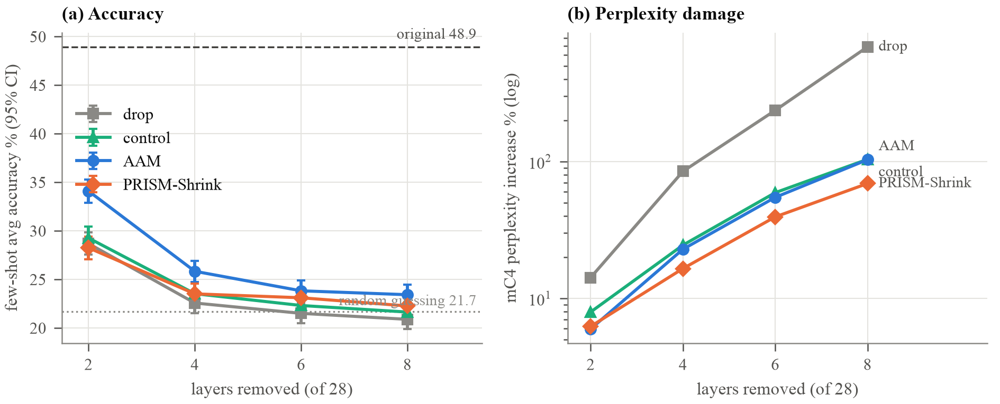
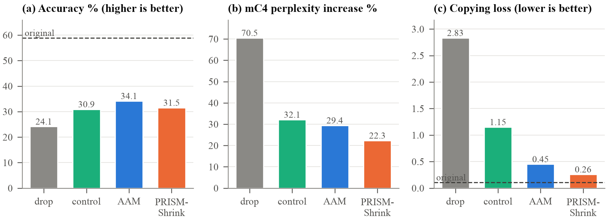
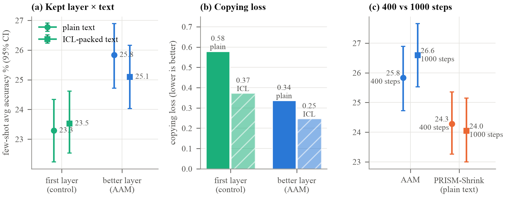
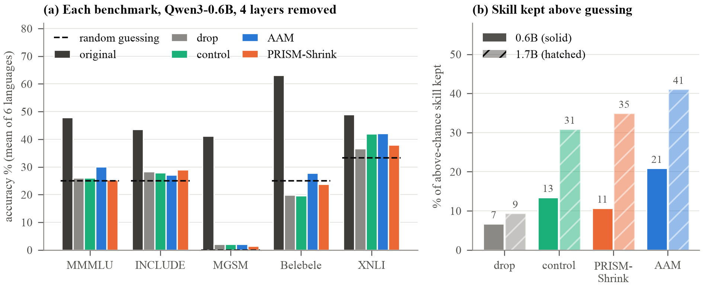

# Metrics and benchmarks: what was measured, how, and what the numbers mean

This note explains **every number** in this project for someone who knows basic NLP (tokens, a language model
predicting the next word) and nothing more. For the full table of every run, see
[`../results/all_metrics.md`](../results/all_metrics.md) (generated by `tools/make_metrics.py`).

Contents

1. [The models that were tested](#1-the-models-that-were-tested)
2. [The test data](#2-the-test-data)
3. [The five benchmarks](#3-the-five-benchmarks)
4. [The measurements (metrics), one by one](#4-the-measurements-metrics-one-by-one)
5. [When is a difference real? (statistics in plain words)](#5-when-is-a-difference-real-statistics-in-plain-words)
6. [The results in one place](#6-the-results-in-one-place)
7. [Compared with random guessing](#7-compared-with-random-guessing)
8. [Compared with Qwen's official numbers](#8-compared-with-qwens-official-numbers)
9. [Compared with quantization and with published layer-removal work](#9-compared-with-quantization-and-with-published-layer-removal-work)
10. [Where every number is stored](#10-where-every-number-is-stored)

---

## 1. The models that were tested

| | Qwen3-0.6B-Base | Qwen3-1.7B-Base |
|---|---|---|
| Layers (transformer blocks) | 28 | 28 |
| Parameters | 596 million | about 1.7 billion |
| One layer is | 2.64 % of the parameters | about 2.9 % |
| Training | **pretrained only** (no SFT, no RL) | pretrained only |
| Precision used | fp32 (fp16 for evaluation, checked to agree within 2 %) | fp16 original model, fp32 for the trained layers |

**"Base" means pretrained only.** Qwen also publishes `Qwen3-0.6B` (without "-Base"), which is post-trained with
supervised fine-tuning (SFT) and reinforcement learning (RL) to follow instructions and chat. This project uses the
**Base** models: a base model is judged by *few-shot* prompting (examples in the prompt), which is exactly what the
benchmarks below do. Checked in every notebook's settings: `model="Qwen/Qwen3-0.6B-Base"` / `"Qwen/Qwen3-1.7B-Base"`.

---

## 2. The test data

**Languages.** Six "training" languages: English (en), Hindi (hi), French (fr), Spanish (es), German (de), Chinese (zh).
Two "unseen" languages, Japanese (ja) and Russian (ru), are **only tested**, never used to build or train anything, to
see whether damage spreads to languages the method never saw.

**Rule: test data is never used for fitting or choosing anything.** Calibration and training text come from the
Wiki-40B *train* split; all tests come from separate test splits.

Size of the test per language (Qwen3-0.6B, from `analysis/test_set/test_tokens_Qwen3-0.6B-Base.csv`):

| language | perplexity tokens | MMMLU | INCLUDE | MGSM | Belebele | XNLI | unique test tokens |
|---|---|---|---|---|---|---|---|
| en | 65,536 | 19,843 | — | 15,286 | 31,732 | 6,696 | 139,093 |
| hi | 65,536 | 76,240 | 35,821 | — | 125,899 | 27,256 | 330,752 |
| fr | 65,536 | 29,539 | 13,234 | 20,123 | 48,191 | 9,745 | 186,368 |
| es | 65,536 | 27,310 | 14,718 | 19,444 | 46,049 | 8,864 | 181,921 |
| de | 65,536 | 30,154 | 12,136 | 20,433 | 45,038 | 9,555 | 182,852 |
| zh | 65,536 | 20,438 | 13,182 | 16,413 | 34,696 | 6,023 | 156,288 |
| ja (unseen) | 65,536 | 27,722 | 39,083 | 20,132 | 45,456 | — | 197,929 |
| ru (unseen) | 65,536 | — | 17,840 | 22,841 | 51,374 | 10,772 | 168,363 |

Every language has **more than 100,000 unique test tokens**. Questions per benchmark and language: MMMLU 200,
INCLUDE 200, MGSM 250 (all of them), Belebele 200, XNLI 200. A dash means the benchmark has no data for that language
(MGSM has no Hindi, INCLUDE has no English).

---

## 3. The five benchmarks

All five are run **few-shot**: the prompt first shows a few solved examples ("shots"), then the real question. The
model never sees the test answers during building or training.

| Benchmark | What it tests | Example (shortened) | Shots | How the answer is read | Random guessing |
|---|---|---|---|---|---|
| **MMMLU** (English: MMLU) | school and university knowledge, 57 subjects, translated | "Which gas makes up most of the air? A) O₂ B) N₂ C) CO₂ D) Ar. Answer:" | 5 | which of the tokens " A", " B", " C", " D" gets the highest score | **25 %** |
| **INCLUDE** | knowledge from real local exams written in each language (not translated) | a question from a Hindi civil-service exam | 5 | same, A/B/C/D | **25 %** |
| **MGSM** | grade-school maths word problems, translated | "Roger has 5 balls and buys 2 cans of 3 balls. How many balls?" | 4, with worked steps (chain of thought) | the model writes its own answer; the last number must equal the right answer | **0 %** (you cannot guess a number) |
| **Belebele** | reading comprehension: a passage and a question about it | passage about a city + "What is the city famous for? A) … D) …" | 3 | A/B/C/D | **25 %** |
| **XNLI** | does sentence 2 follow from sentence 1? (yes / maybe / no) | "The man is sleeping, right? No, he is running." | 3 (one per label) | which of the 3 completed sentences the model finds most likely | **33 %** |

**avg acc** (the main accuracy number) = the mean of the five benchmark accuracies, each averaged over the six
languages. Because the chance levels differ, **random guessing on every benchmark gives an avg acc of 21.7 %, not
25 %** (see section 7).

**Competence check.** A test cell (benchmark × language) can only show damage if the *original* model is clearly
better than chance on it. `tools/analyze.py` checks this for every cell and flags the cells where the lower end of the
95 % range is within 2 points of chance (⚠). Only one cell is flagged: German XNLI on the 0.6B model.

---

## 4. The measurements (metrics), one by one

### 4.1 Accuracy (%)
The share of questions answered correctly. Higher is better.

### 4.2 Skill kept (%), above random guessing
Raw accuracy hides how close a model is to guessing. Skill kept fixes that:

```
skill kept = (model accuracy − chance) / (original accuracy − chance)       per benchmark, then averaged
```

Worked example, MMMLU on Qwen3-0.6B: original 47.9 %, chance 25 %, AAM with 4 layers removed 30.1 %.
Skill kept = (30.1 − 25) / (47.9 − 25) = 5.1 / 22.9 = **22 %**. So 0 % = no better than guessing, 100 % = as good
as the original. It can go below 0 when a damaged model does worse than guessing (section 7).

### 4.3 Perplexity and "perplexity increase %"
**Perplexity** measures how surprised the model is by real text. If the model's perplexity is 20, it is, on average,
as unsure as if it were choosing between 20 equally likely next tokens. Lower is better.

```
perplexity = exp( average over tokens of  −log P(correct next token) )
```

It is measured on two kinds of text per language: **mC4** (web text) and **Wiki-40B test** (Wikipedia), 32,768
tokens each. Because the six languages have very different perplexities, results are given as the **increase over
the original model**, averaged over languages:

```
perplexity increase % = (perplexity of the cut model / perplexity of the original − 1) × 100
```

Example: original mC4 perplexity in German 20.0, cut model 24.0 → +20 %. +0 % = no damage.

### 4.4 Copying loss (copy NLL)
Few-shot prompting depends on the model **copying patterns from earlier in the prompt** (done by "induction heads",
attention heads that look back for the previous occurrence of the current token and predict what came next).
The probe: 32 sequences of 128 **random** tokens, each shown twice. On the second copy the original model can predict
almost every token by copying. The number is the average negative log-probability (NLL) on the second copy.

- Original model: 0.125 (0.6B), 0.106 (1.7B): near-perfect copying.
- Lower is better. Above about 1 means copying is badly broken (drop at 4 layers: 2.22).
- It uses random tokens, so it is the same in every language.

### 4.5 Parameters cut (%)
Share of the model's parameters removed. One Qwen3-0.6B layer = 2.64 %, so 2 / 4 / 6 / 8 layers = 5.3 / 10.6 / 15.8 /
21.1 %. The token embedding table (26 % of the 0.6B model) is never touched.

### 4.6 Speed (tokens per second)
- **Prefill**: how many prompt tokens per second the model reads (one 1,024-token prompt).
- **Decode**: how many new tokens per second it writes (64 tokens, one at a time, with a KV cache).

Measured on a Kaggle T4 GPU inside each run. These are **noisy** (shared machines; the same model varies by about
±10 % between runs), so only the trend is meaningful: removing 4 of 28 layers makes the model roughly 10–20 % faster.

---

## 5. When is a difference real? (statistics in plain words)

With 200 questions, a model's accuracy on one benchmark and language moves by several points just from *which*
questions were picked. Two tools separate real differences from luck:

- **95 % confidence interval (CI)**, written `25.8 [24.7, 26.9]`: if the test were repeated with new questions of
  the same kind, the result would land in this range 95 % of the time. Made by **bootstrapping**: resample the
  questions with replacement 1,000+ times and look at the spread of the results.
- **Paired test and p-value**: two models are compared **on the same questions** (paired), resampling the questions
  together. The p-value is the chance of seeing a difference this large if there were really none.
  **p < 0.05 = a real difference**; p = 0.4 = could easily be luck.
- **Seeds**: training uses random choices (which text, which order). Running the same method with seeds 0, 1 and 2
  shows whether a result depends on lucky randomness. The main 4-layer runs were repeated with 3 seeds; their
  accuracy varied by less than 0.7 points.

---

## 6. The results in one place

### 6.1 Qwen3-0.6B-Base (original: avg acc 48.9 %, copying 0.125)

| layers removed | method | avg acc % | vs drop (p) | skill kept % | mC4 perplexity | copying |
|---|---|---|---|---|---|---|
| 2 | drop | 28.7 | — | 32 | +14.2 % | 0.320 |
| 2 | control (drop + same training) | 29.3 | +0.6 (0.20) | 35 | +7.9 % | 0.172 |
| 2 | **AAM** | **34.1** | **+5.4 (< 0.001)** | **53** | +6.0 % | 0.203 |
| 2 | PRISM-Shrink + ICL | 28.2 | −0.4 (0.45) | 31 | +6.2 % | **0.131** |
| 4 | drop | 22.6 | — | 7 | +84.7 % | 2.220 |
| 4 | control | 23.5 | +1.0 (0.05) | 13 | +24.5 % | 0.372 |
| 4 | **AAM** | **25.8** | **+3.3 (< 0.001)** | **21** | +22.8 % | 0.337 |
| 4 | PRISM-Shrink + ICL | 23.5 | +0.9 (0.15) | 11 | **+16.5 %** | **0.212** |
| 6 | drop | 21.5 | — | 1 | +236.6 % | 4.292 |
| 6 | control | 22.3 | +0.8 (0.17) | 4 | +59.2 % | 0.506 |
| 6 | **AAM** | **23.8** | **+2.3 (0.001)** | **12** | +54.7 % | 0.519 |
| 6 | PRISM-Shrink + ICL | 23.1 | +1.6 (0.011) | 7 | **+39.4 %** | **0.340** |
| 8 | drop | 20.9 | — | −2 | +689.4 % | 10.112 |
| 8 | control | 21.6 | +0.7 (0.21) | 1 | +103.8 % | 1.091 |
| 8 | **AAM** | **23.4** | **+2.5 (< 0.001)** | **10** | +103.1 % | 0.766 |
| 8 | PRISM-Shrink + ICL | 22.3 | +1.4 (0.017) | 4 | **+69.0 %** | **0.651** |



### 6.2 Qwen3-1.7B-Base, 4 layers removed (original: avg acc 58.9 %, copying 0.106)

| method | avg acc % | vs drop (p) | skill kept % | mC4 perplexity | copying |
|---|---|---|---|---|---|
| drop | 24.1 | — | 9 | +70.5 % | 2.831 |
| control | 30.9 | +6.8 (< 0.001) | 31 | +32.1 % | 1.150 |
| **AAM** | **34.1** | **+10.0 (< 0.001)** | **41** | +29.4 % | 0.450 |
| PRISM-Shrink | 31.5 | +7.4 (< 0.001) | 35 | **+22.3 %** | **0.257** |



### 6.3 Repeat runs and ablations (Qwen3-0.6B, 4 layers removed)

| question | answer |
|---|---|
| Is it luck? (3 seeds) | AAM 25.8 ± 0.3, PRISM-Shrink 23.6 ± 0.1, control 23.6 ± 0.1. AAM beats the control on every seed (p ≤ 0.009). |
| Why does AAM win? | Keeping the **better** layer of each pair: +1.6 to +2.5 points over keeping the first, with the same text. |
| Does ICL-packed training text help? | Not accuracy (moves it by at most 0.8); it lowers the copying loss (AAM 0.34 → 0.25). |
| Does longer training help? (400 → 1,000 steps) | Perplexity −2 points; accuracy at most +0.8 (AAM, p = 0.05); copying gets worse. |



---

## 7. Compared with random guessing



| setting | drop | control | PRISM-Shrink | AAM |
|---|---|---|---|---|
| 0.6B, 2 layers removed | 32 % | 35 % | 31 % | **53 %** |
| 0.6B, 4 layers removed | 7 % | 13 % | 11 % | **21 %** |
| 0.6B, 8 layers removed | −2 % | 1 % | 4 % | **10 %** |
| 1.7B, 4 layers removed | 9 % | 31 % | 35 % | **41 %** |

(skill kept above random guessing, section 4.2)

What this shows, honestly:

- **Random guessing gives 21.7 % avg acc**, so the 0.6B models with 4+ layers removed (21–26 %) are **close to
  guessing**. Their perplexity can still be repaired a lot (+85 % → +17 %), but their benchmark skill mostly is not.
- **Maths breaks first.** MGSM falls from 41 % to about 2 % for every method at 4 layers: multi-step reasoning needs
  the full depth.
- **Below chance on Belebele.** drop and the control score about 20 % on a 4-choice test (chance 25 %). A damaged
  model tends to prefer one answer letter whatever the question; if that letter is right less than a quarter of the
  time, accuracy falls below chance.
- **At 2 layers removed, AAM keeps about half the skill**, and **the bigger model keeps twice as much** at 4 layers
  (41 % vs 21 %). Small models have little spare depth.

---

## 8. Compared with Qwen's official numbers

The original models' scores on this test, next to the Qwen3 Technical Report (Table 8, base models; MMLU, MMMLU and
INCLUDE 5-shot, MGSM 8-shot with chain of thought):

| benchmark | this test, 0.6B | official, 0.6B | this test, 1.7B | official, 1.7B |
|---|---|---|---|---|
| MMLU (English) | 54 | 52.8 | 59 | 62.6 |
| MMMLU (multilingual) | 47.9 | 50.2 | 50.9 | 63.3 |
| INCLUDE | 43.6 | 34.3 | 54.6 | 45.6 |
| MGSM | 41.2 | 31.0 | 58.8 | 50.7 |

The numbers are in the same range; the gaps come from **different languages** (6 here, 14–44 officially), **different
question subsets** (200–250 per language), **fewer MGSM shots** (4 vs 8) and **different prompts**. English MMLU, the
most comparable cell, agrees within 1–4 points, so the evaluation code behaves as expected.

---

## 9. Compared with quantization and with published layer-removal work

**Quantization** stores each weight with fewer bits (16 → 8 or 4) instead of removing layers. Published results for
Qwen3 (*An Empirical Study of Qwen3 Quantization*, 2025):

| method | memory saved | accuracy change |
|---|---|---|
| 8-bit quantization | 50 % | near-lossless for Qwen3 0.6B–14B |
| 4-bit quantization | 75 % | Qwen3-8B MMLU 74.7 → 69.3 (−5.4 points) |
| **AAM, 2 layers removed (this work, 0.6B)** | 5 % | 48.9 → 34.1 (**−14.8**) |
| **AAM, 4 layers removed (this work, 0.6B)** | 11 % | 48.9 → 25.8 (**−23.1**) |
| **AAM, 4 layers removed (this work, 1.7B)** | 12 % | 58.9 → 34.1 (**−24.8**) |

**For saving memory, quantization is far better.** Layer removal is useful for a different reason: it reduces the
number of sequential steps, so the model runs faster (here roughly 10–20 % at 4 of 28 layers), and it can be
**combined** with quantization. The lesson of this project is that a 0.6B–1.7B model has little spare depth.

**Published layer-removal results on bigger models.** FlattenGPT (2026), which merges adjacent layers into one wide
layer and prunes it back, keeps 86–96 % of the original's zero-shot score at about 20 % compression on 7B–70B
models. Those tests (PIQA, HellaSwag, ARC, WinoGrande) are easier and in English only, and some have 50 % chance, so
the percentages are not directly comparable; the trend (bigger models lose much less) matches the 0.6B → 1.7B trend
here.

Sources: [Qwen3 Technical Report](https://arxiv.org/abs/2505.09388),
[An Empirical Study of Qwen3 Quantization](https://arxiv.org/abs/2505.02214),
[FlattenGPT](https://arxiv.org/abs/2602.08858).

---

## 10. Where every number is stored

| what | where |
|---|---|
| every measurement of every large-test run (accuracy per benchmark and language, perplexity per language, copying, speed, skill kept) | [`../results/all_metrics.md`](../results/all_metrics.md) |
| large-test table with confidence intervals and p-values, and the competence check | [`../results/large_test_results.md`](../results/large_test_results.md) |
| the earlier small test (all 15 experiments) | [`../results/small_test_results.md`](../results/small_test_results.md) |
| the raw results of one run (one JSON row per model, with every question's right/wrong) | `<method folder>/runs/<notebook>/results/results_*.json` |
| the log of one run | `<method folder>/runs/<notebook>/run.log` |
| figures | [`figures/`](figures/) (rebuild with `tools/make_figures.py`) |

To rebuild all tables from the run folders:

```
python3 tools/analyze.py . > results/large_test_results.md
python3 tools/make_metrics.py . > results/all_metrics.md
python3 tools/make_figures.py          # needs matplotlib
```
