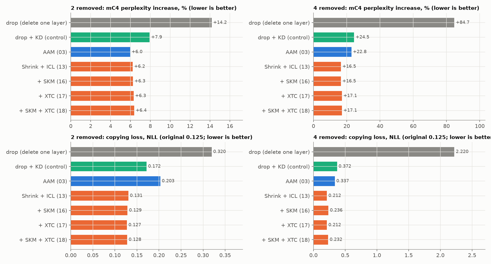

# PRISM-Shrink: merge a pair into one wide layer, then shrink it gradually

**In one sentence:** run two neighbouring layers side by side as one double-width layer (which is almost the same as
running them one after the other), then slowly switch off half of its parts while training it to copy the original
model, until it is a normal-size layer.

**Result in one sentence:** the lowest perplexity damage and the best in-context copying from 4 layers removed on,
on both model sizes and every seed, but **no accuracy gain** over the matched control (drop + the same training).

**Prior work:** the "one wide layer, then prune it back" idea was published as FlattenGPT (arXiv 2602.08858, 2026),
which prunes in one step without training. What this folder adds is the gradual, distilled shrinking, the ICL-packed
training text, and the multilingual controlled test. See the README's Prior work section.

New to the terms? Read [`../docs/metrics_and_benchmarks.md`](../docs/metrics_and_benchmarks.md) first.

---

## 1. The idea in plain words

**PRISM** stands for Parallel-Residual Interaction-Sum Merge. Each layer adds a correction to the token's running
state h. Two layers in a row compute:

```
one after the other (original):   h  +  A(h)  +  B( h + A(h) )
side by side (PRISM):             h  +  A(h)  +  B( h )
```

The only difference is that B reads `h` instead of `h + A(h)`. In the middle of the model A's correction is small
(the input to layer A and to layer B point in almost the same direction: cosine 0.96–0.97), so the two are close.

Side by side, A and B are **exactly one wider layer**: A's attention heads plus B's attention heads, and A's MLP
neurons plus B's MLP neurons, all reading the same input. Nothing is averaged, so nothing gets mixed up (averaging two
layers' weights fails because their neurons are not lined up; that was shown in Assignment 1).

The wide layer is twice too big, so it must be shrunk back to normal size. Cutting half of it in one step loses a
lot; PRISM-Shrink instead **fades the dropped half out slowly while training**, so the kept half can take over its
work.

```
  layer A (8 head groups, 3,072 neurons)  ┐
                                           ├─► wide layer U (16 head groups, 6,144 neurons, side by side)
  layer B (8 head groups, 3,072 neurons)  ┘
         │
         ▼  choose the 8 head groups and 3,072 neurons that matter most
         ▼  fade the other half out (α: 1 → 0) while distilling from the original model
         ▼
  one normal layer (8 head groups, 3,072 neurons)  =  a standard Qwen3 layer
```

## 2. The algorithm, step by step

1. **Choose the pairs**: the same angular-distance pairs as every method (e.g. 10-11, 12-13, 14-15, 16-17 for 4
   layers removed), so all methods are compared on the same cuts.
2. **Build the exact wide layer** (`prism_layer`):
   - Each layer starts with a normalisation step (RMSNorm) that has its own scale per dimension. Fold each layer's
     scale into its own input weights, so the wide layer can use one shared normalisation (exact, because RMSNorm
     only rescales each token).
   - Stack A's and B's attention head groups (a "KV group" = one key/value head and the 2 query heads that share it)
     and A's and B's MLP neurons. Each head group keeps its own small q/k normalisation gains (+5,632 parameters).
   - Check: with all parts of one layer, the construction reproduces that layer exactly (error < 0.01 %).
3. **Choose what to keep** ("write energy"): run calibration text through the wide layer and measure, per part, how
   much it writes into the token state (for a head group: the size of its output; for a neuron: its activation ×
   the size of its output weights), measured relative to each token's own size. Keep the top 8 of 16 head groups and
   the top 3,072 of 6,144 neurons.
4. **Shrink gradually** (the `Shrink` module):
   ```
   output = α · B(A(h))  +  (1 − α) · U_α(h)
   ```
   where `U_α` is the wide layer with every **dropped** part multiplied by α. At α = 1 this is exactly the original
   pair; at α = 0 only the kept parts remain. The whole wide layer trains while α goes from 1 to 0 (cosine curve over
   280 steps, then 120 steps at 0).
5. **Distill** with the shared recipe: KL divergence to the original model's next-token probabilities + hidden-state
   MSE, AdamW, learning rate 5e-5, 400 steps, one 256-token passage per language per step.
6. **Extract** the kept parts into a normal layer. Check: the trained wide layer at α = 0 and the extracted layer give
   the same error (17.7 % = 17.7 % for pair 12-13).

**"+ ICL"** (in-context-learning packing, used in the main runs): each training sequence is built as
`[passage a] [passage b in another language] [passage a again]` (768 tokens). On the repeat the original model copies
almost perfectly, so learning to match it trains the copying skill few-shot prompts need.

**Memory note:** the wide layer is twice the size and trained in fp32, so deep cuts and the 1.7B model split each
batch into smaller pieces (`mb_tokens` 512 or 256). This gives the same gradient with less GPU memory.

## 3. Where it is in the code

| notebook section | what it does |
|---|---|
| PRISM library | `prism_layer` (step 2), `components` and `select` (step 3), `_selfcheck` |
| Shared distillation code | `ALPHA`, `kd_losses`, `kd_train` |
| Shrink library | `Shrink` (step 4), `extract` (step 6), `packed_batch_fn` (ICL packing), `shrink_build` (all steps) |
| Algorithm | `ALGO = "prism_shrink_icl_energy0.7"` (ICL) or `"prism_shrink_energy0.7"` (plain), `build = shrink_build(...)` |
| Run and results | `run_all`: build, evaluate, write the results JSON |

The other cells (settings, data, evaluation, planner) are the same in every notebook; see
[`../aam/README.md`](../aam/README.md) section 3.

## 4. The runs and their numbers

Each notebook `X.ipynb` has its log and results in `runs/X/`. Accuracy = few-shot avg acc (chance 21.7 %).

| notebook | what it tests | model | layers removed | avg acc % | skill kept % | mC4 perplexity | copying |
|---|---|---|---|---|---|---|---|
| `prism_shrink_icl_large_test` | main run (+ ICL) | 0.6B | 2 | 28.2 | 31 | +6.2 % | **0.131** |
| `prism_shrink_icl_large_test` | main run (+ ICL) | 0.6B | 4 | 23.5 | 11 | **+16.5 %** | **0.212** |
| `prism_shrink_icl_seed1` | same, seed 1 | 0.6B | 4 | 23.7 | 11 | +16.8 % | 0.233 |
| `prism_shrink_icl_seed2` | same, seed 2 | 0.6B | 4 | 23.5 | 11 | +16.4 % | 0.247 |
| `prism_shrink_icl_deep6` | deeper cut | 0.6B | 6 | 23.1 | 7 | **+39.4 %** | **0.340** |
| `prism_shrink_icl_deep8` | deeper cut | 0.6B | 8 | 22.3 | 4 | **+69.0 %** | **0.651** |
| `prism_shrink_plain` | plain training text | 0.6B | 4 | 24.3 | 13 | +17.5 % | 0.218 |
| `prism_shrink_plain_steps1000` | 1,000 training steps | 0.6B | 4 | 24.0 | 14 | +15.8 % | 0.339 |
| `prism_shrink_17b` | bigger model (plain text) | 1.7B | 4 | 31.5 | 35 | **+22.3 %** | **0.257** |
| `prism_shrink` | earlier small test (notebook 11) | 0.6B | 2 / 4 | 30.8 / 24.7 | — | +6.9 / +18.8 % | — |
| `prism_shrink_icl` | earlier small test (notebook 13) | 0.6B | 2 / 4 | 30.1 / 23.8 | — | +6.7 / +17.9 % | — |

For comparison at 4 layers on 0.6B: drop +84.7 % perplexity (copying 2.22), control +24.5 % (0.372), AAM +22.8 %
(0.337). Every measurement per benchmark and language: [`../results/all_metrics.md`](../results/all_metrics.md).

**Compared with the matched control**, paired on the same questions:

| setting | accuracy: Shrink − control | p-value | perplexity |
|---|---|---|---|
| 0.6B, 2 layers | −1.0 | 0.07 | +6.2 % vs +7.9 % |
| 0.6B, 4 layers, seeds 0 / 1 / 2 | −0.0 / +0.1 / +0.0 | 0.98 / 0.91 / 0.96 | +16.6 % vs +24.2 % (mean of 3 seeds) |
| 0.6B, 6 layers | +0.8 | 0.11 | +39.4 % vs +59.2 % |
| 0.6B, 8 layers | +0.6 | 0.26 | +69.0 % vs +103.8 % |
| 1.7B, 4 layers | +0.6 | 0.34 | +22.3 % vs +32.1 % |

From 4 layers on, its perplexity is lower than both the control's and AAM's in **every one of the 6 languages, on
both mC4 and Wikipedia**, at every depth and on both models.



## 5. What the experiments showed

- **It is the best way here to keep the model's text prediction and copying**: about a third less perplexity damage
  than the control at 4 layers (+16.6 % vs +24.2 %), and copying loss 0.23 vs 0.44.
- **It does not improve benchmark accuracy** over the control at any depth (all differences within ±1 point, never
  significant). Better text prediction does not turn into better answers here.
- **Very stable**: three seeds give 23.6 ± 0.1 accuracy and +16.4 to +16.8 % perplexity.
- **Proof that it really merges** (does not just keep one layer): keeping only A's parts or only B's parts is worse
  than the merged layer for every pair (small test, notebook 07).

**Weak points:**
- No accuracy gain; AAM (keep the better layer) is more accurate.
- It needs twice the memory during training.
- The core idea is close to published work (FlattenGPT).

More detail: [`../docs/algorithm_notes.md`](../docs/algorithm_notes.md) sections "PRISM", 11 and 13, and
[`../docs/layer_merging_explained.md`](../docs/layer_merging_explained.md) "PRISM: the core idea" and sections 11, 13.
